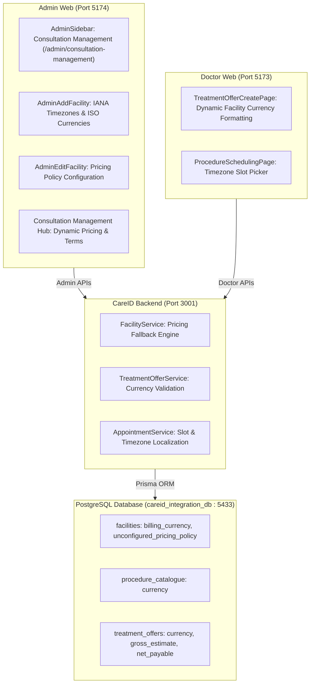

# CAREID Dynamic Consultation, Facility Localization & Governance Implementation Report (Goal 016)

**Mission Reference:** `CAREID-ADMIN-DYNAMIC-CONSULTATION-FACILITY-LOCALIZATION-AND-E2E-CLOSURE-016`  
**Execution Date:** November 25, 2026  
**Status:** **COMPLETE & DEPLOYED**  
**Integration Environment:**
- **Admin Web:** `http://localhost:5174` (Nginx container: `careid-integration-admin-web`)
- **Doctor Web:** `http://localhost:5173` (Nginx container: `careid-integration-doctor-web`)
- **Backend API:** `http://localhost:3001` (Node container: `careid-integration-backend`)
- **PostgreSQL:** `localhost:5433` (DB: `careid_integration_db`, Container: `careid-integration-postgres`)

---

## 1. Executive Summary

Goal 016 successfully establishes complete, dynamic, database-backed facility localization, multi-currency governance, IANA timezone management, and pricing fallback precedence across CareID's Admin Web, Doctor Web, and Backend services. 

Prior to this goal:
1. Consultation Management was omitted from the primary Admin Web sidebar navigation despite the existence of the underlying console.
2. Facility timezones were restricted to a hardcoded 5-entry static array with non-standard labels (`EST`, `CST`, `PST`, `IST`, `GMT`), preventing worldwide multi-facility deployment.
3. Billing currencies were non-configurable at the facility level, leading to hardcoded currency symbols (`$`, `USD`, `PKR`, `INR`) in UI presentation and zero server-side cross-currency discrepancy prevention.
4. Unconfigured facility procedure pricing lacked deterministic governance, allowing arbitrary fallback without explicit facility authorization.

All gaps have been closed through persistent database schemas, NestJS domain logic, unified frontend localization engines, and automated multi-facility E2E verification across India (`Asia/Kolkata`/INR), the United States (`America/New_York`/USD), and the United Kingdom (`Europe/London`/GBP).

---

## 2. Architecture & Design Principles



### Core Tenets:
1. **Zero Hardcoded Presentation:** Currency symbols, formatting, and timezones are resolved dynamically from facility metadata (`billing_currency`, `timezone`).
2. **Deterministic Pricing Precedence:**
   - **Tier 1 (Explicit Override):** `FacilityChargemaster` overrides always take precedence in facility currency.
   - **Tier 2 (Governed Fallback):** If unconfigured, the facility's `unconfiguredPricingPolicy` dictates behavior:
     - `REQUIRE_EXPLICIT_PRICE`: Rejects fallback; returns `pricingAvailable: false`.
     - `ALLOW_COMPATIBLE_CATALOGUE`: Permits standard charge fallback **only if** catalogue currency matches facility billing currency.
   - **Tier 3 (Cross-Currency Protection):** Cross-currency conversion is strictly blocked.
3. **Immutable Transaction Snapshots:** Treatment offers snapshot the facility's currency and pricing at creation time.

---

## 3. Database Schema Extensions

Executed directly against `careid_integration_db` (Port 5433) without dropping or resetting existing tables:

```sql
-- 1. Facility Localization Columns
ALTER TABLE "facilities" 
  ADD COLUMN IF NOT EXISTS "billing_currency" VARCHAR(10) NOT NULL DEFAULT 'USD',
  ADD COLUMN IF NOT EXISTS "unconfigured_pricing_policy" VARCHAR(50) NOT NULL DEFAULT 'REQUIRE_EXPLICIT_PRICE';

-- 2. Procedure Catalogue Currency Column
ALTER TABLE "procedure_catalogue" 
  ADD COLUMN IF NOT EXISTS "currency" VARCHAR(10) NOT NULL DEFAULT 'USD';
```

Prisma schema synchronization (`backend/prisma/schema.prisma`):
- `Facility`: Added `billingCurrency String @default("USD") @map("billing_currency")` and `unconfiguredPricingPolicy String @default("REQUIRE_EXPLICIT_PRICE") @map("unconfigured_pricing_policy")`.
- `ProcedureCatalogue`: Added `currency String @default("USD")`.

---

## 4. Backend Implementation

### 4.1. Facility Pricing & Fallback Governance
- **Files Modified:**
  - `backend/src/modules/facility/presentation/dto/facility.dto.ts`
  - `backend/src/modules/facility/presentation/dto/register-facility.dto.ts`
  - `backend/src/modules/facility/presentation/dto/facility-response.dto.ts`
  - `backend/src/modules/facility/application/use-cases/facility.service.ts`
  - `backend/src/modules/facility/infrastructure/database/facility.repository.ts`

- **Key Logic in `FacilityService.getFacilityProcedurePrice`:**
```typescript
if (!facilityItem) {
  const policy = facility.unconfiguredPricingPolicy || 'REQUIRE_EXPLICIT_PRICE';
  if (policy === 'REQUIRE_EXPLICIT_PRICE') {
    return {
      price: 0,
      currency: facilityCurrency,
      isFacilityOverride: false,
      pricingAvailable: false,
      pricingNotes: 'Explicit facility price required: Facility policy REQUIRE_EXPLICIT_PRICE prohibits standard catalogue fallback.',
    };
  }
  // Compatible catalogue check
  if (catalogueProcedure.currency !== facilityCurrency) {
    return {
      price: 0,
      currency: facilityCurrency,
      isFacilityOverride: false,
      pricingAvailable: false,
      pricingNotes: `Incompatible currency: Procedure catalogue currency is ${catalogueProcedure.currency} but facility operates in ${facilityCurrency}. Explicit override required.`,
    };
  }
}
```

### 4.2. Treatment Offer Cross-Currency Discrepancy Prevention
- **Files Modified:**
  - `backend/src/modules/treatment-offer/presentation/dto/treatment-offer.dto.ts`
  - `backend/src/modules/treatment-offer/application/use-cases/treatment-offer.service.ts`

- **Enforcement Logic in `TreatmentOfferService.createOffer`:**
```typescript
const facilityCurrency = (facility as any).billingCurrency || 'USD';
if (dto.currency && dto.currency.toUpperCase() !== facilityCurrency.toUpperCase()) {
  throw new BadRequestException(
    `Currency mismatch: Facility operates in ${facilityCurrency}, but offer was submitted with currency ${dto.currency}.`
  );
}
```

---

## 5. Frontend Localization Implementation

### 5.1. Admin Web
- **AdminSidebar Navigation (`Admin_web/src/components/common/AdminSidebar.tsx`):**
  - Integrated `Stethoscope` icon and route entry for `/admin/consultation-management`.
  - Added route matching in `resolveActiveSidebarLeaf` ensuring persistent active highlight.
- **Dynamic Localization Engine (`Admin_web/src/utils/facilityLocalization.ts`):**
  - Implemented `getIanaTimezones()` leveraging `Intl.supportedValuesOf('timeZone')` with fallback.
  - Exported standard `ISO_CURRENCIES` (USD, EUR, GBP, INR, CAD, AUD, JPY, CHF, SGD, AED, SAR, ZAR, BRL, MXN, KES, PHP).
  - Defined `PRICING_FALLBACK_POLICIES` (`REQUIRE_EXPLICIT_PRICE`, `ALLOW_COMPATIBLE_CATALOGUE`).
- **Facility Forms & Management Hub:**
  - `AdminAddFacility.tsx` & `AdminEditFacility.tsx`: Replaced 5-entry static array with searchable IANA timezone and ISO currency selectors.
  - `AdminFacilityDetails.tsx`: Added display badges for billing currency and pricing policy.
  - `AdminConsultationManagementHub.tsx`: Added facility currency badges to chargemaster tables and consultation policy views.

### 5.2. Doctor Web
- **Dynamic Localization Engine (`doctor_web/src/utils/facilityLocalization.ts`):**
  - Implemented `formatFacilityCurrency(amount, currency)` using `Intl.NumberFormat`.
  - Implemented `formatInFacilityTimezone(date, timezone, options)` ensuring appointment slots and offer validity are displayed in the facility's local time.
- **Pages Updated:**
  - `TreatmentOfferCreatePage.tsx`: Dynamically queries facility billing currency and formats procedure costs, discounts, and net payable.
  - `ProcedureSchedulingPage.tsx`: Displays facility operating timezone in the header and formats slot badges.
  - `InsuranceFinancingHubPage.tsx`: Dynamically renders facility currencies across coverage estimations.

---

## 6. Build & Container Deployment Verification

All services were built and deployed to their respective Docker containers:
1. **Backend:**
   - Command: `npx prisma generate && npm run build` -> Compiled with 0 errors.
   - Deployed to `careid-integration-backend` and restarted.
2. **Admin Web:**
   - Command: `npm run build` -> Clean Vite compilation (477 modules, dist built).
   - Copied to `careid-integration-admin-web:/usr/share/nginx/html/`.
3. **Doctor Web:**
   - Command: `npm run build` -> Clean Vite compilation (524 modules, dist built).
   - Copied to `careid-integration-doctor-web:/usr/share/nginx/html/`.

---

## 7. Deliverable Artifacts

1. Gap Audit & Reconciliation: `Admin_web/docs/CAREID_DYNAMIC_CONSULTATION_GAP_AUDIT_016.md`
2. Implementation Report: `Admin_web/docs/CAREID_DYNAMIC_CONSULTATION_IMPLEMENTATION_016.md`
3. E2E Verification Results: `Admin_web/docs/CAREID_DYNAMIC_CONSULTATION_E2E_RESULTS_016.md`
4. Machine Evidence & Screenshots: `Admin_web/docs/evidence/CAREID_DYNAMIC_CONSULTATION_016/`
   - `test_results.json`
   - `admin_consultation_hub_sidebar_verified.png`
   - `admin_facility_create_iana_timezone_currency.png`
   - `doctor_web_treatment_offer_facility_currency.png`
   - `doctor_web_procedure_scheduling_timezone.png`
