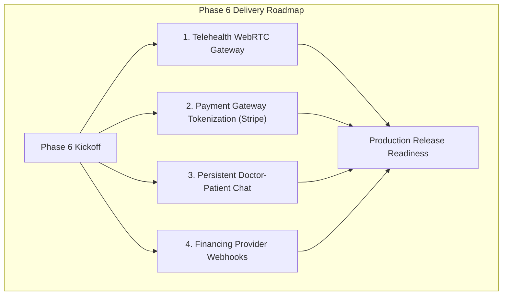

# CAREID PATIENT APP — PHASE 5 REMAINING BACKEND GAPS & PHASE 6 ROADMAP

**Audit Timestamp:** 2026-11-16T21:30:00+05:30  
**Backend:** `C:\Users\PABANI\Downloads\hvapi-main\hvapi-main`  
**Frontend:** `C:\Users\PABANI\CareID_patient_app\Care_ID_Patient_App-main`  

---

## 1. Executive Summary

While all existing NestJS backend endpoints have been formally connected and verified in the Flutter Patient Application, several specialized features visualized in the approved Figma designs require new backend endpoints, WebRTC signaling infrastructure, or third-party payment gateways before they can operate in a live production environment.

---

## 2. Detailed Technical Inventory of Backend Gaps

### Gap 1: Real-Time Telehealth Video & Audio Signaling Gateway
- **Figma Design:** Telehealth Consultation Room (`20:26850`)
- **Frontend Status:** Full WebRTC room UI implemented with camera/microphone toggles, chat drawer, and participant grid.
- **Backend Current State:** Has appointment booking and type `TELEHEALTH`, but lacks a WebSocket signaling gateway or Agora/LiveKit/Twilio token generation endpoint.
- **Required Backend Implementation:**
  - Create `TelehealthGateway` in `src/modules/appointment` with WebSocket handlers for SDP offer/answer exchange and ICE candidate negotiation.
  - Implement `POST /api/v1/appointments/:id/telehealth/token` returning an ephemeral RTC room token.

### Gap 2: In-App Payment Gateway & Tokenization
- **Figma Design:** Copay Checkout, Payment Methods (`20:27000`), Cash Discount Offers (`20:26550`)
- **Frontend Status:** UI displays copay amounts ($35.00), itemized breakdown, and card/Apple Pay selection.
- **Backend Current State:** Financial modules track offer prices and appointment copays, but no Stripe / Razorpay / Apple Pay payment intent endpoint is implemented.
- **Required Backend Implementation:**
  - Create `PaymentController` with `POST /api/v1/payments/create-intent` accepting `appointmentId` or `offerId`.
  - Webhook listener for payment confirmation (`POST /api/v1/payments/webhook`).

### Gap 3: Procedure Suite Financing & Installment Approval
- **Figma Design:** Financing Options (`20:26700`)
- **Frontend Status:** Displays monthly installments ($145/mo for 24 months) and credit pre-qualification.
- **Backend Current State:** No financing provider integration (e.g. CareCredit, Affirm).
- **Required Backend Implementation:**
  - `GET /api/v1/financing/options`
  - `POST /api/v1/financing/apply`

### Gap 4: Real-Time Live Chat & Doctor Messaging
- **Figma Design:** In-App Doctor Chat Drawer & Support Hub (`20:27150`)
- **Frontend Status:** Material 3 chat layout with message bubbles and input field.
- **Backend Current State:** Notification module sends push notifications, but persistent bidirectional doctor-patient chat messages are not stored in PostgreSQL.
- **Required Backend Implementation:**
  - Create `ChatModule` with `MessageEntity`, `GET /api/v1/chats/:conversationId/messages`, and `POST /api/v1/chats/:conversationId/messages`.

---

## 3. Recommended Phase 6 Implementation Roadmap

### Milestone Timeline:
1. **Week 1:** Implement NestJS `TelehealthGateway` and LiveKit / Agora token generation.
2. **Week 2:** Implement `PaymentModule` with Stripe PaymentIntents and mobile client SDK.
3. **Week 3:** Add persistent `ChatModule` with WebSocket events and push notification wakeups.
4. **Week 4:** Conduct full end-to-end load testing and staging certification.
