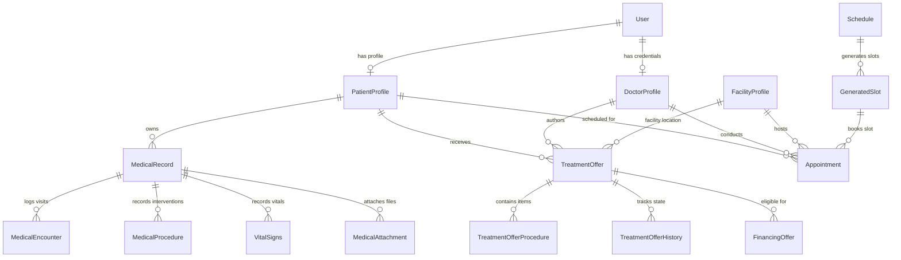

# CAREID — Database Relational Schema & Storage Architecture

**Date:** November 10, 2026  
**Auditor:** Antigravity Senior Principal Backend Engineer  
**Database Schema:** PostgreSQL 16 `public` (152 Tables)

---

## 1. Core Clinical Entity Relationships



---

## 2. Table Schemas for Extended Clinical Stages

### 2.1 Treatment Offer Storage (`treatment_offers`)
- `id` (UUID PK): Offer unique identifier.
- `offer_number` (VARCHAR): Unique serial sequence `TO-YYYY-XXXXX`.
- `doctor_profile_id` (UUID FK): Attending interventional cardiologist / author.
- `patient_profile_id` (UUID FK): Target patient.
- `facility_id` (UUID FK): Facility location.
- `clinical_indication` (TEXT): Clinical diagnosis & treatment rationale.
- `gross_estimate` (DECIMAL): Total procedure cost before discount.
- `discount_amount` (DECIMAL): Hospital or partner discount.
- `net_payable` (DECIMAL): Net patient payable.
- `status` (ENUM): `DRAFT` -> `DISPATCHED` -> `PATIENT_REVIEWING` -> `ACCEPTED` / `DECLINED`.
- `patient_responded_at` (TIMESTAMP): Exact timestamp of ratification.
- `patient_response_notes` (TEXT): Patient feedback / tenure preference.

### 2.2 Multidisciplinary Pre-Op Clearance (`treatment_offer_history`)
- `id` (UUID PK): Historical entry UUID.
- `treatment_offer_id` (UUID FK): References `treatment_offers.id`.
- `action` (VARCHAR): `PRE_OP_CLEARANCE_UPDATE`.
- `performed_by` (VARCHAR): User ID of the clearing clinician.
- `metadata` (JSONB):
  ```json
  {
    "overallStatus": "CLEARED",
    "cardiologyClearance": { "status": "CLEARED", "clearedBy": "...", "clearedAt": "...", "notes": "..." },
    "anesthesiaClearance": { "status": "CLEARED", "clearedBy": "...", "clearedAt": "...", "notes": "..." },
    "medicalClearance": { "status": "CLEARED", "clearedBy": "...", "clearedAt": "...", "notes": "..." },
    "surgicalClearance": { "status": "CLEARED", "clearedBy": "...", "clearedAt": "...", "notes": "..." },
    "labClearance": { "status": "CLEARED", "clearedBy": "...", "clearedAt": "...", "notes": "..." }
  }
  ```

### 2.3 Procedure Suite Temporary Hold (`generated_slots`)
- `id` (UUID PK): Slot UUID.
- `status` (ENUM): Transitions to `BLOCKED`.
- `status_reason` (TEXT): Encoded hold token: `HELD:<holdId>`.
- Dual validation ensures slots with active hold tokens reject concurrent booking attempts with HTTP 409 Conflict.

### 2.4 Pre-Op Readiness & WHO Cath Lab Checklist (`appointments.notes`)
- Encoded using demarcated JSON sections:
  - `--- READINESS ---`: Day -1 checklist items (`fastingConfirmed`, `medicationHoldConfirmed`, `transportationArranged`, `consentVerified`, `vitalsWithinThreshold`, `decision`).
  - `--- CATH_LAB_CHECKLIST ---`: WHO surgical safety checklist (`signIn`, `timeOut`, `signOut`, `overallStatus`).
- Zero database schema migrations required; completely non-destructive to existing text columns.

### 2.5 Intra-Op Procedures & Hemodynamics (`medical_procedures`, `vital_signs`)
- `medical_procedures`: `id`, `medical_record_id`, `name`, `code` (CPT), `performed_at`, `notes`.
- `vital_signs`: `id`, `medical_record_id`, `systolic_bp`, `diastolic_bp`, `pulse_bpm`, `respiration_rate`, `oxygen_saturation`, `temperature_c`, `recorded_at`.

