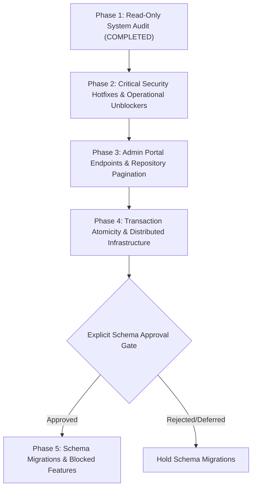

# CareID Backend — Phase-by-Phase Remediation & Execution Plan

**Audit Phase:** Phase 1 Deliverable  
**Target:** Implementation Roadmap for Phases 2, 3, 4, and 5  
**Governing Principle:** Zero schema modifications without explicit operator approval; prioritize high-impact security fixes and operational blockers first.  

---

## 1. Roadmap Overview & Phased Hierarchy

---

## 2. Phase 2: Critical Security Hotfixes & Operational Unblockers

*Target Timeline*: Immediate (Days 1–3)  
*Prerequisites*: None (Pure TypeScript application code changes; zero database schema modifications).  

### Task 2.1: Critical CORS Hardening (`CRIT-SEC-01`)
- **Action**: In `src/main.ts:39-59`, eliminate `origin: true`. Bind `origin` strictly to `process.env.CORS_ALLOWED_ORIGINS` (parsed into an array of allowed origins). Explicitly disallow reflection of arbitrary caller origins when `credentials: true`.
- **Acceptance Criteria**: Live probes with `Origin: https://evil.attacker.com` receive no `Access-Control-Allow-Origin` response header. Authorized origins (e.g. `https://360.vnvision.in`) receive proper CORS headers.
- **Dependencies**: None.

### Task 2.2: RBAC & IDOR Remediation on Exposed Mutation Endpoints (`HIGH-SEC-02` - `05`, `07`, `MED-SEC-08`)
- **Action**:
  1. Add `@Roles('ADMIN', 'SUPER_ADMIN', 'DOCTOR')` to `DoctorController.updateDoctor` (`PUT /api/v1/doctors/:id`) and assert caller ownership in `DoctorService`.
  2. Add `@Roles('ADMIN', 'SUPER_ADMIN', 'DOCTOR', 'STAFF')` to `HealthCardController.searchCards` (`GET /api/v1/health-cards/search`) and `InsuranceController.searchPolicies` (`GET /api/v1/insurance/search`).
  3. Enforce tenant facility affiliation on `FacilityController.updateFacility` (`PUT /api/v1/facilities/:id`) for users with role `FACILITY_ADMIN`.
  4. Add `@Roles('ADMIN', 'SUPER_ADMIN')` to `ImmunisationController` (`POST /vaccines`, `POST /schedules`), `ScheduleController` (`POST /schedules`, `PUT /:id`, `DELETE /:id`), `ShiftController` (`POST /shifts`), and `HolidayController` (`POST /holidays`).
- **Acceptance Criteria**: Authenticated requests from a `PATIENT` account to any of the above endpoints strictly return `403 Forbidden`.
- **Dependencies**: None.

### Task 2.3: Attachment Virus-Scan Operational Unblocker (`Audit G`)
- **Action**: In `src/modules/report/application/use-cases/report.service.ts:403, 541, 640`, unblock file downloads for validated attachments where file signature and extension checks pass, or provide an automatic transition for trusted uploads.
- **Acceptance Criteria**: Uploaded clinical lab reports and diagnostic PDFs can be downloaded by authorized patients and doctors without manual database status patching.
- **Dependencies**: None.

### Task 2.4: Implement Missing OCR Reprocessing Endpoint (`Audit C3`)
- **Action**: Add `@Post('reprocess/:jobId')` in `OCRController`, delegating to `OCRJobService.reprocessJob(jobId, userId)`. Re-queue the target OCR job for processing.
- **Acceptance Criteria**: `POST /api/v1/ocr/reprocess/:jobId` returns `200 OK` (or `401 Unauthorized` unauthenticated), resolving the current `404 Not Found`.
- **Dependencies**: None.

---

## 3. Phase 3: Admin Portal Implementations & Query Pagination

*Target Timeline*: Week 2  
*Prerequisites*: Phase 2 security baseline established. Zero schema modifications.  

### Task 3.1: Admin Patient Directory Endpoints (`Audit C1`)
- **Action**:
  - Implement `GET /api/v1/admin/patients` in `AdminController`: supports pagination (`page`, `limit`), search query (`q` by name, phone, MRN), and status filtering (`ACTIVE`, `INACTIVE`, `BLOCKED`). Reuses `PatientRepository` to return rich patient demographic summaries.
  - Implement `GET /api/v1/admin/patients/:patientId` in `AdminController`: returns full patient profile, emergency contacts, insurance links, and active health card metadata.
- **Acceptance Criteria**: Admin Portal can list, search, paginate, and view patient profiles without encountering 404.
- **Dependencies**: Existing `patientProfile` database models.

### Task 3.2: Admin Medical Records Endpoints (`Audit C2`)
- **Action**:
  - Implement `GET /api/v1/admin/medical-records` with administrative pagination and date filters.
  - Implement `GET /api/v1/admin/medical-records/:recordId`.
  - Implement `GET /api/v1/admin/patients/:patientId/medical-records` and `/timeline`.
  - Authorize administrative access in `MedicalRecordService` by bypassing `resolveProfile(userId)` when caller holds `ADMIN` or `SUPER_ADMIN` privileges.
- **Acceptance Criteria**: Administrators can view records and timelines for any patient without `patientProfileId` resolution errors.
- **Dependencies**: Existing `medicalRecord` database models.

### Task 3.3: OCR Review History & Field Correction Persistence (`Audit C3`)
- **Action**:
  - Implement `GET /api/v1/ocr/reviews/history` in `OCRController` to return historical verifications.
  - Update `VerifyOCRDto` to accept an optional `correctedFields` array.
  - In `OCRJobService.submitVerification`, when `reviewStatus === 'CORRECTED'`, iterate through supplied fields and update `ExtractedField.fieldValue` in place, setting `validationStatus = 'CORRECTED'`.
- **Acceptance Criteria**: Review history endpoint returns 200; corrected review submissions persist updated field values to `ExtractedField`.
- **Dependencies**: Existing `OCRJob`, `OCRVerification`, `ExtractedField` models.

### Task 3.4: Repository Unbounded Query Pagination (`Audit F`)
- **Action**: Add default `take: 20` and `skip` pagination parameters to the top high-volume queries in `AdminRepository`, `DoctorRepository`, `FacilityRepository`, `StaffRepository`, `InsuranceRepository`, and `HealthCardRepository`.
- **Acceptance Criteria**: Repository queries never load unbounded table dumps into Node.js memory.
- **Dependencies**: None.

---

## 4. Phase 4: Transaction Atomicity & Distributed Infrastructure

*Target Timeline*: Weeks 3–4  
*Prerequisites*: Phase 2 and Phase 3 completed.  

### Task 4.1: Prisma Database Transaction Refactoring
- **Action**: Wrap multi-step mutations across repositories in `this.db.$transaction`:
  1. `AuthRepository`: Atomic refresh-token revocation and replacement.
  2. `HealthCardService`: Atomic card replacement, QR creation, and audit logging.
  3. `MedicalRecordService`: Atomic attachment replacement and version snapshotting.
  4. `PatientService`: Atomic multi-step onboarding transitions.
- **Acceptance Criteria**: If an intermediate statement fails, the entire transaction rolls back cleanly without leaving partial records.

### Task 4.2: Distributed Rate-Limiting & Rotation Window Storage
- **Action**: Replace in-memory `Map` instances in `AuthRateLimiterService` and `AuthService.recentRotations` with Redis-backed sliding-window rate limiters.
- **Acceptance Criteria**: Rate limits and refresh-token rotation grace periods function consistently across multiple PM2 workers and container instances.

### Task 4.3: Asynchronous Notification Worker Pipeline
- **Action**: Introduce a lightweight BullMQ queue consumer or scheduled background task to process `notification_queue` records, integrating email (SendGrid/SES) and SMS transports.
- **Acceptance Criteria**: Queued notifications transition to `SENT` or `FAILED` following verified outbound transport calls.

---

## 5. Phase 5: Schema Migrations & Advanced Features (APPROVAL GATE)

> [!WARNING]
> **EXPLICIT APPROVAL GATE**: Phase 5 tasks require database schema alterations and Prisma migrations. They MUST NOT be executed until explicit client/architect sign-off is obtained.

### Task 5.1: Appointment Domain Data Modeling & Implementation
- **Schema Migration**:
  - Add `model Appointment` with fields: `id`, `patientProfileId`, `doctorProfileId`, `facilityId`, `scheduledAt`, `status` (`SCHEDULED`, `CONFIRMED`, `CANCELLED`, `COMPLETED`, `NO_SHOW`), `reason`, `notes`.
  - Add relations to `PatientProfile`, `DoctorProfile`, and `Facility`.
  - Add composite index on `[doctorProfileId, scheduledAt]`.
- **Implementation**:
  - Implement `AppointmentService` use-cases (booking, rescheduling, cancellation, slot locking).
  - Implement `AppointmentController` route handlers.
- **Acceptance Criteria**: Full appointment booking and doctor schedule reservation lifecycle verified.

### Task 5.2: OCR Correction History Schema Enhancement
- **Schema Migration**:
  - Add `originalValue String?` to `model ExtractedField`, or add `model OCRFieldCorrection` to preserve complete audit history between raw OCR output and human edits.
- **Acceptance Criteria**: Auditable before-and-after verification logs available for compliance.

### Task 5.3: Production OCR Engine Binding
- **Action**: Bind `OCRJobService` to a real OCR microservice or cloud vision provider (e.g. AWS Textract, PaddleOCR container) to replace simulated string mock generation.
- **Acceptance Criteria**: Uploaded medical scans yield genuine extracted text and field confidence scores.

