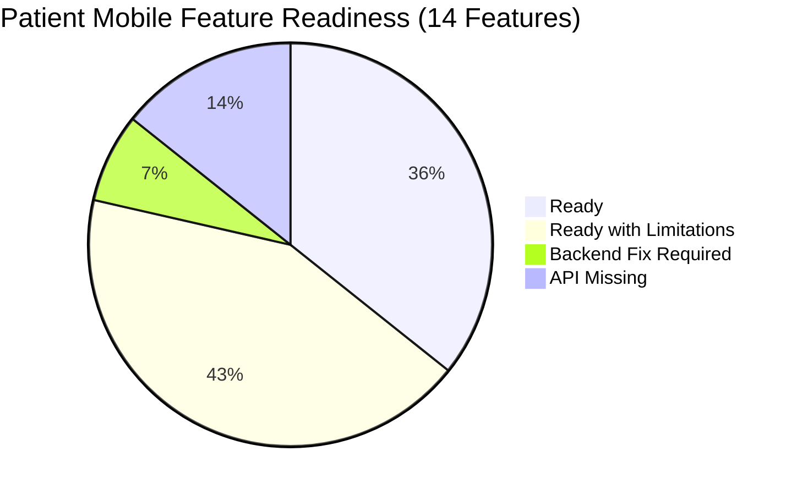
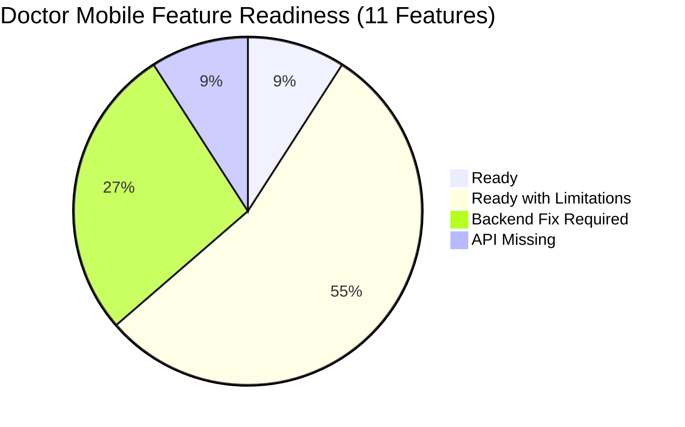

# CareID Backend — Phase 4: API Readiness & Flutter Integration Audit Executive Summary

**Audit Date:** October 2026  
**Audited Platform:** CareID / Health Vault 360 Backend Monolith (`hvapi`)  
**Production Server:** `https://360api.vnvision.in` (`/www/wwwroot/360api.vnvision.in`)  
**Stack:** NestJS 11.1.28, TypeScript 5.7, Prisma 7.9.1, PostgreSQL  
**Audit Mode:** STRICT READ-ONLY GATE  

---

## 1. Executive Summary

Phase 4 conducted an exhaustive, read-only architectural and API contract audit of the CareID backend monolith to assess readiness for Flutter mobile client integration (Patient App and Doctor App).

The audit verified **435 HTTP endpoints** across 28 controllers against `docs/swagger-spec.json` and the authoritative staging Postman collection (`CareID-Staging.postman_collection.json`), evaluated operational infrastructure (CORS, ClamAV antivirus, B2 storage, OCR, notifications, rate limiting), and produced an actionable Flutter integration guide.





---

## 2. Key Audit Metrics & Scorecards

| Metric | Target | Verified Value | Compliance | Status / Notes |
|---|---|---|---|---|
| **Registered Routes** | N/A | **435 Operations** across 321 Paths | 100% | Verified via NestJS AST and Swagger |
| **OpenAPI Parity** | 435 | **435 Operations** | 100% | Identical to controller registry |
| **Postman Parity** | 435 | **427 Operations** | 98.2% | 8 Phase 3 admin/OCR endpoints missing in Postman |
| **Patient Feature Readiness** | 14 Features | **11 / 14 (78.6%)** Viable | Partial | 5 Ready, 6 With Limitations, 1 Fix, 2 Missing |
| **Doctor Feature Readiness** | 11 Features | **7 / 11 (63.6%)** Viable | Blocked | 1 Ready, 6 With Limitations, 3 Fix, 1 Missing |
| **Prisma Schema Size** | 111,057 B | **111,057 Bytes** | 100% | Zero schema modifications during Phase 4 |

---

## 3. High-Priority Operational Blockers

### Blocker 1: Antivirus `PENDING` Download Lock (Patient & Doctor App)
- **Impact:** Critical. Newly uploaded diagnostic reports and attachments cannot be downloaded or previewed.
- **Root Cause:** Uploads initialize with `virusScanStatus: 'PENDING'`. No background scanner runs to update files to `'CLEAN'`. The download controller strictly enforces `virusScanStatus === 'CLEAN'` and throws `400 Bad Request`.
- **Classification:** Backend Code Defect / Missing Worker.

### Blocker 2: Doctor Inability to Access or Document Clinical Records (Doctor App)
- **Impact:** Critical launch blocker for the Doctor mobile app.
- **Root Cause:** `MedicalRecordController` is hardcoded to look up the caller's own `PatientProfile`. Doctors (who possess `DoctorProfile`) receive `404 Not Found`. Administrative patient record routes reject doctors with `403 Forbidden`. Doctors have zero endpoints to view patient medical history or document clinical encounter notes.
- **Classification:** Backend Architectural Gap.

### Blocker 3: Unimplemented Appointment Subsystem (Patient & Doctor App)
- **Impact:** Mobile users cannot book, view, cancel, or manage appointments.
- **Root Cause:** `AppointmentController`, `AppointmentService`, and `AppointmentRepository` in `src/modules/appointment/` are empty scaffolding stubs marked `// TODO: Phase 5 Implementation`.
- **Classification:** Planned Feature Gap (Scheduled for Phase 5).

### Blocker 4: Absence of SMS Gateway Integration in Production (Auth)
- **Impact:** Real users in production (`APP_ENV=production`) cannot receive SMS OTPs.
- **Root Cause:** `requestOtp` hashes a cryptographic random OTP in PostgreSQL, but does not invoke an external SMS gateway (Twilio, Gupshup, AWS SNS). Works only with pre-configured test phone numbers.
- **Classification:** Production Integration Gap.

### Blocker 5: Dual Route Collision on `/api/v1/reports`
- **Impact:** High cognitive overhead and fragility.
- **Root Cause:** Both `ReportController` (patient clinical diagnostic reports) and `ReportsController` (BI analytics) register `@Controller('reports')`. Relies fragilely on module ordering in `app.module.ts`.
- **Classification:** Architecture Defect.

---

## 4. Deliverables Index

The following deliverables have been produced during Phase 4:

1. **`docs/audit/phase-4-api-contract-audit.md`**  
   Exhaustive comparison between Postman, OpenAPI, and NestJS controllers, detailing all 435 endpoints, route collisions, pagination inconsistencies, and RBAC analysis.
2. **`docs/audit/phase-4-patient-api-readiness.md`**  
   Readiness matrix and endpoint inventory for the 14 Patient Flutter features with concrete payload models and integration caveats.
3. **`docs/audit/phase-4-doctor-api-readiness.md`**  
   Readiness matrix and endpoint inventory for the 11 Doctor Flutter features, isolating clinical documentation blockers and workarounds.
4. **`docs/audit/phase-4-operational-blockers.md`**  
   Production infrastructure audit covering CORS, Backblaze B2, ClamAV antivirus, simulated vs genuine OCR, notification queues, clustering, and PII logging.
5. **`docs/integration/careid-flutter-api-integration-guide.md`**  
   Comprehensive developer guide for the Flutter engineering team, detailing Base URLs, authentication headers, Dio token refresh interceptor, model deserialization, and the "DO NOT CALL" list.
6. **`docs/audit/phase-4-executive-summary.md`**  
   This executive summary and roadmap.

---

## 5. Recommended Phase 5 Implementation Sequence

To achieve mobile launch readiness, development should proceed in four sequential tracks:

```mermaid
flowchart TD
    subgraph Track 1: P0 Immediate Unblockers
        A1[Fix File Download Antivirus PENDING Lock] --> A2[Implement Doctor Encounter & Patient Access API]
        A2 --> A3[Add GET /api/v1/doctors/me Route]
    end

    subgraph Track 2: P1 Core Workflows
        B1[Implement AppointmentModule Booking Engine] --> B2[Integrate Production SMS Gateway Provider]
    end

    subgraph Track 3: P2 Mobile Optimization
        C1[Add Pagination to Patient Medical Timeline & Reports] --> C2[Standardize Pagination Envelopes]
        C2 --> C3[Integrate FCM/APNs Device Tokens & Push Worker]
    end

    subgraph Track 4: P3 Architecture & OCR
        D1[Separate /reports Route Collision to /analytics] --> D2[Integrate Live OCR Engine via PaddleOCR]
    end

    Track 1 --> Track 2
    Track 2 --> Track 3
    Track 3 --> Track 4
```

1. **Track 1 (Immediate Unblockers):**
   - Resolve the download lock in `report.service.ts`.
   - Provide doctors with authorized read/write endpoints for patient clinical encounters.
   - Add `GET /api/v1/doctors/me` to eliminate phone-search workarounds.
2. **Track 2 (Core Mobile Workflows):**
   - Implement `AppointmentController`, `AppointmentService`, and repository state machine.
   - Wire Twilio/AWS SNS SMS dispatch in `auth.service.ts`.
3. **Track 3 (Mobile Optimization):**
   - Add query pagination (`page`, `limit`) to patient timeline and reports.
   - Implement Firebase Cloud Messaging (FCM) device token registration for push alerts.
4. **Track 4 (Long-term Architecture):**
   - Relocate BI reporting to `/api/v1/analytics`.
   - Replace simulated OCR with genuine PaddleOCR or Google Cloud Vision processing.

