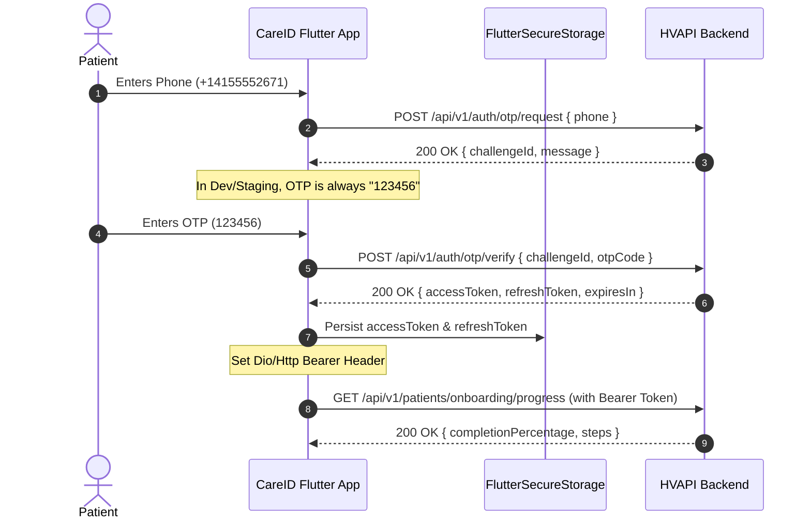

# CareID Patient App — Flutter API Integration Contract

**Document Version:** 1.0.0 (Authoritative)  
**Target Backend:** Health Vault 360 Enterprise API (`hvapi`)  
**Base URL:** `https://360api.vnvision.in`  
**API Prefix:** `/api/v1`  
**Target Client:** CareID Patient Flutter App  
**Architecture Standard:** Clean Architecture / Repository Pattern / BLoC or Riverpod  

---

## 1. Global Network & Envelope Specifications

### 1.1 Base Configuration
```dart
const String kApiBaseUrl = 'https://360api.vnvision.in';
const String kApiPrefix = '/api/v1';
```

### 1.2 Mandatory Request Headers
| Header | Value | Condition |
| :--- | :--- | :--- |
| `Content-Type` | `application/json` | Required on all POST / PUT / PATCH requests (No `multipart/form-data`) |
| `Accept` | `application/json` | Required on all requests |
| `Authorization` | `Bearer <accessToken>` | Required on all protected endpoints |

### 1.3 Standard Response Envelope
All backend responses are wrapped by the NestJS response interceptor:

```json
{
  "success": true,
  "statusCode": 200,
  "message": "Operation executed successfully",
  "data": { /* Actual payload here */ },
  "meta": {
    "timestamp": "2026-10-25T12:00:00.000Z"
  }
}
```

### 1.4 Standard Error Envelope
All failures (HTTP 400, 401, 403, 404, 409, 500) follow this structure:

```json
{
  "success": false,
  "statusCode": 400,
  "error": "BadRequestException",
  "message": "Detailed error message or validation failure array",
  "meta": {
    "timestamp": "2026-10-25T12:00:00.000Z",
    "path": "/api/v1/patients/onboarding/insurance",
    "traceId": "optional-trace-id"
  }
}
```

*Note on Validation Errors:* If class-validator fails multiple fields, `message` will be a `List<String>`, e.g. `["phone must follow E.164 format", "name should not be empty"]`.

---

## 2. Authentication & Token Lifecycle Guide



### 2.1 Token Storage Expectations
* **`accessToken`**: Store in `FlutterSecureStorage`. Lifetime is **15 minutes**.
* **`refreshToken`**: Store in `FlutterSecureStorage`. Lifetime is **7 days**.
* **Automatic Refresh Strategy:** When any API call returns `401 Unauthorized`, intercept the response using a Dio `QueuedInterceptor`, execute `POST /api/v1/auth/token/refresh` with `{ "refreshToken": storedRefreshToken }`, update stored tokens, and retry the failed request.
* **Logout:** Call `POST /api/v1/auth/logout` with `{ "refreshToken": storedRefreshToken }` and wipe local secure storage.

---

## 3. Onboarding Workflow & Step-by-Step Contracts

```
[Step 1: Register Draft] ──> POST /api/v1/patients/register
          │
          ▼
[Step 2: Demographics]   ──> POST /api/v1/patients/onboarding/demographics
          │
          ▼
[Step 3: Emergency Info] ──> POST /api/v1/patients/onboarding/emergency-contact
          │
          ▼
[Step 4: Insurance Info] ──> POST /api/v1/patients/onboarding/insurance
          │
          ▼
[Step 5: Health Card]    ──> POST /api/v1/patients/onboarding/health-card
          │
          ▼
[Step 6: Family Invite]  ──> POST /api/v1/patients/onboarding/family-invite
          │
          ▼
[Finalize Onboarding]    ──> POST /api/v1/patients/onboarding/complete
```

---

### Step 1: Initialize Draft Registration
* **Endpoint:** `POST /api/v1/patients/register`
* **Auth:** Bearer JWT
* **Content-Type:** `application/json`
* **Request Body:** `{}` (empty JSON object)
* **Response (201 Created):**
```json
{
  "success": true,
  "statusCode": 201,
  "message": "Operation executed successfully",
  "data": {
    "profileId": "b1b86e08-1152-4752-9da5-3a059524e931",
    "patientNumber": "PT-1761300000000",
    "status": "DRAFT",
    "onboardingStep": 1
  },
  "meta": { "timestamp": "2026-10-25T12:00:00.000Z" }
}
```
*Note:* If user has already registered a profile, returns `400 Bad Request: Patient profile already registered for this user`. The app should catch this and call `GET /api/v1/patients/onboarding/progress` to resume.

---

### Step 2: Demographics
* **Endpoint:** `POST /api/v1/patients/onboarding/demographics` (or `PUT` to update)
* **Auth:** Bearer JWT
* **Request Body:**
```json
{
  "firstName": "Jane",
  "lastName": "Doe",
  "dateOfBirth": "1994-06-15",
  "gender": "Female",
  "bloodGroup": "O+",
  "address": "742 Evergreen Terrace, Springfield"
}
```
*Constraints:*
* `firstName`: String, required, non-empty.
* `lastName`: String, required, non-empty.
* `dateOfBirth`: String ISO date (`YYYY-MM-DD`), required.
* `gender`: String, required. Must be exactly one of: `"Male"`, `"Female"`, `"Other"`.
* `bloodGroup`: String, optional (e.g. `"A+"`, `"O+"`, `"B-"`).
* `address`: String, optional.
* **Response (200 OK):**
```json
{
  "success": true,
  "statusCode": 200,
  "message": "Operation executed successfully",
  "data": {
    "profileId": "b1b86e08-1152-4752-9da5-3a059524e931",
    "message": "Demographics onboarding completed successfully",
    "nextStep": 3
  },
  "meta": { "timestamp": "2026-10-25T12:00:00.000Z" }
}
```

---

### Step 3: Emergency Contact
* **Endpoint:** `POST /api/v1/patients/onboarding/emergency-contact` (or `PUT` to update)
* **Auth:** Bearer JWT
* **Prerequisite:** Step 2 must be completed (`onboardingStep >= 2`).
* **Request Body:**
```json
{
  "name": "John Doe",
  "relationship": "Spouse",
  "phone": "+14155559876"
}
```
*Constraints:*
* `name`: String, required, non-empty.
* `relationship`: String, required, non-empty (e.g. `"Spouse"`, `"Parent"`, `"Sibling"`).
* `phone`: String, required. Must be in E.164 international format (`^\+[1-9]\d{1,14}$`).
* **Critical Rule:** `phone` **cannot** be identical to the patient's registered phone number (will throw `400 Bad Request`).
* **Response (200 OK):**
```json
{
  "success": true,
  "statusCode": 200,
  "message": "Operation executed successfully",
  "data": {
    "contactId": "c2c86e08-2252-4752-9da5-3a059524e932",
    "message": "Emergency information onboarding completed successfully",
    "nextStep": 4
  },
  "meta": { "timestamp": "2026-10-25T12:00:00.000Z" }
}
```

---

### Step 4: Add Insurance Info
* **Endpoint:** `POST /api/v1/patients/onboarding/insurance` (or `PUT` to update)
* **Auth:** Bearer JWT
* **Prerequisite:** Step 3 must be completed (`onboardingStep >= 3`).
* **Request Body:**
```json
{
  "providerName": "MetLife Healthcare",
  "policyNumber": "POL-10029302",
  "coverageDetails": "Comprehensive Medical Plan A",
  "expiryDate": "2028-12-31",
  "secondaryProvider": "Aetna Life",
  "secondaryPolicyNumber": "POL-20038491",
  "secondaryCoverage": "Dental and Vision Rider"
}
```
*Field Specifications:*
| Field | Type | Required | Notes |
| :--- | :--- | :--- | :--- |
| `providerName` | `String` | **Yes** | Insurance provider company |
| `policyNumber` | `String` | **Yes** | Member / policy ID |
| `coverageDetails`| `String` | No | Description of plan |
| `expiryDate` | `String` | **Yes** | Expiration date in `YYYY-MM-DD` |
| `secondaryProvider` | `String` | No | Optional secondary insurance |
| `secondaryPolicyNumber` | `String` | No | Optional secondary policy ID |
| `secondaryCoverage` | `String` | No | Optional secondary coverage details |

* **Response (200 OK):**
```json
{
  "success": true,
  "statusCode": 200,
  "message": "Operation executed successfully",
  "data": {
    "policyId": "d3d86e08-3352-4752-9da5-3a059524e933",
    "message": "Primary and optional secondary insurance linked successfully",
    "nextStep": 5
  },
  "meta": { "timestamp": "2026-10-25T12:00:00.000Z" }
}
```

---

### Step 5: Digital Health Card Initialization
* **Endpoint:** `POST /api/v1/patients/onboarding/health-card`
* **Auth:** Bearer JWT
* **Prerequisite:** Step 4 must be completed (`onboardingStep >= 4`).
* **Request Body:** `{}` (empty JSON object)
* **Response (200 OK):**
```json
{
  "success": true,
  "statusCode": 200,
  "message": "Operation executed successfully",
  "data": {
    "cardId": "e4e86e08-4452-4752-9da5-3a059524e934",
    "cardNumber": "HC-1761300000000",
    "message": "Digital Health Card initialized successfully",
    "nextStep": 6
  },
  "meta": { "timestamp": "2026-10-25T12:00:00.000Z" }
}
```

---

### Step 6: Family Linkage Invitation
* **Endpoint:** `POST /api/v1/patients/onboarding/family-invite`
* **Auth:** Bearer JWT
* **Prerequisite:** Step 5 must be completed (`onboardingStep >= 5`).
* **Request Body:**
```json
{
  "inviteePhone": "+14155551122",
  "relationship": "Child"
}
```
* **Response (200 OK):** Returns `{ "consentId": "...", "message": "Family invitation sent successfully", "nextStep": 6 }`.

---

### Step 7: Finalize Onboarding
* **Endpoint:** `POST /api/v1/patients/onboarding/complete`
* **Auth:** Bearer JWT
* **Operation:** Checks that demographics, emergency contact, insurance, and health card are all present. Transitions status from `"DRAFT"` to `"COMPLETED"` and sets `onboardingStep = 7`.
* **Request Body:** `{}` (empty JSON object)
* **Response (200 OK):**
```json
{
  "success": true,
  "statusCode": 200,
  "message": "Operation executed successfully",
  "data": {
    "success": true,
    "message": "Onboarding completed and profile finalized successfully"
  },
  "meta": { "timestamp": "2026-10-25T12:00:00.000Z" }
}
```

---

### Progress Tracking
* **Endpoint:** `GET /api/v1/patients/onboarding/progress`
* **Auth:** Bearer JWT
* **Response (200 OK):**
```json
{
  "success": true,
  "statusCode": 200,
  "message": "Operation executed successfully",
  "data": {
    "completionPercentage": 67,
    "status": "DRAFT",
    "steps": [
      { "step": 1, "name": "Identity Verification", "completed": true },
      { "step": 2, "name": "Patient Demographics", "completed": true },
      { "step": 3, "name": "Emergency Contact", "completed": true },
      { "step": 4, "name": "Insurance Mapping", "completed": true },
      { "step": 5, "name": "Health Card Initialization", "completed": false },
      { "step": 6, "name": "Family Invitation", "completed": false }
    ]
  },
  "meta": { "timestamp": "2026-10-25T12:00:00.000Z" }
}
```

---

## 4. Attachment & Insurance Card Upload Architecture

### 4.1 Strict Architectural Reality
The backend **does not accept multipart file uploads**. All binary files must be uploaded to cloud object storage (or S3/CDN/aaPanel uploads directory) by the client or via your cloud storage provider, and the metadata registered with the backend.

### 4.2 Generic Document Registration (`POST /api/v1/attachments`)
To record the front or back of an insurance card:

```dart
final response = await dio.post(
  '/api/v1/attachments',
  data: {
    'fileName': 'insurance_card_front.jpg',
    'originalName': 'card_front.jpg',
    'fileSize': 1048576, // In bytes (max 15MB)
    'mimeType': 'image/jpeg',
    'category': 'IMAGE', // 'IMAGE' | 'PDF' | 'SCANNED_DOC' | 'OTHER'
    'storageKey': 'cards/user_123/front.jpg',
    'storageUrl': 'https://storage.healthvault360.com/cards/user_123/front.jpg',
  },
);
```

**Response (201 Created):**
```json
{
  "success": true,
  "statusCode": 201,
  "message": "Operation executed successfully",
  "data": {
    "id": "att-456-uuid-v4",
    "patientProfileId": "b1b86e08-1152-4752-9da5-3a059524e931",
    "fileName": "insurance_card_front.jpg",
    "storageUrl": "https://storage.healthvault360.com/cards/user_123/front.jpg",
    "storageKey": "cards/user_123/front.jpg",
    "version": 1,
    "virusScanStatus": "CLEAN",
    "createdAt": "2026-10-25T12:00:00.000Z"
  },
  "meta": { "timestamp": "2026-10-25T12:00:00.000Z" }
}
```

---

## 5. Dart / Flutter Model Mappings

```dart
// Auth Models
class RequestOtpDto {
  final String phone;
  RequestOtpDto({required this.phone});
  Map<String, dynamic> toJson() => {'phone': phone};
}

class VerifyOtpDto {
  final String challengeId;
  final String otpCode;
  VerifyOtpDto({required this.challengeId, required this.otpCode});
  Map<String, dynamic> toJson() => {
    'challengeId': challengeId,
    'otpCode': otpCode,
  };
}

class AuthTokenPair {
  final String accessToken;
  final String refreshToken;
  final String expiresIn;

  AuthTokenPair({
    required this.accessToken,
    required this.refreshToken,
    required this.expiresIn,
  });

  factory AuthTokenPair.fromJson(Map<String, dynamic> json) => AuthTokenPair(
    accessToken: json['accessToken'] as String,
    refreshToken: json['refreshToken'] as String,
    expiresIn: json['expiresIn'] as String? ?? '15m',
  );
}

// Onboarding Step 2: Demographics
class OnboardDemographicsDto {
  final String firstName;
  final String lastName;
  final String dateOfBirth; // YYYY-MM-DD
  final String gender;      // Male | Female | Other
  final String? bloodGroup;
  final String? address;

  OnboardDemographicsDto({
    required this.firstName,
    required this.lastName,
    required this.dateOfBirth,
    required this.gender,
    this.bloodGroup,
    this.address,
  });

  Map<String, dynamic> toJson() => {
    'firstName': firstName,
    'lastName': lastName,
    'dateOfBirth': dateOfBirth,
    'gender': gender,
    if (bloodGroup != null) 'bloodGroup': bloodGroup,
    if (address != null) 'address': address,
  };
}

// Onboarding Step 3: Emergency Contact
class OnboardEmergencyInfoDto {
  final String name;
  final String relationship;
  final String phone; // E.164 format

  OnboardEmergencyInfoDto({
    required this.name,
    required this.relationship,
    required this.phone,
  });

  Map<String, dynamic> toJson() => {
    'name': name,
    'relationship': relationship,
    'phone': phone,
  };
}

// Onboarding Step 4: Insurance Info
class OnboardInsuranceDto {
  final String providerName;
  final String policyNumber;
  final String? coverageDetails;
  final String expiryDate; // YYYY-MM-DD
  final String? secondaryProvider;
  final String? secondaryPolicyNumber;
  final String? secondaryCoverage;

  OnboardInsuranceDto({
    required this.providerName,
    required this.policyNumber,
    this.coverageDetails,
    required this.expiryDate,
    this.secondaryProvider,
    this.secondaryPolicyNumber,
    this.secondaryCoverage,
  });

  Map<String, dynamic> toJson() => {
    'providerName': providerName,
    'policyNumber': policyNumber,
    if (coverageDetails != null) 'coverageDetails': coverageDetails,
    'expiryDate': expiryDate,
    if (secondaryProvider != null) 'secondaryProvider': secondaryProvider,
    if (secondaryPolicyNumber != null) 'secondaryPolicyNumber': secondaryPolicyNumber,
    if (secondaryCoverage != null) 'secondaryCoverage': secondaryCoverage,
  };
}

// Progress Checklist
class OnboardingStepProgress {
  final int step;
  final String name;
  final bool completed;

  OnboardingStepProgress({
    required this.step,
    required this.name,
    required this.completed,
  });

  factory OnboardingStepProgress.fromJson(Map<String, dynamic> json) =>
      OnboardingStepProgress(
        step: json['step'] as int,
        name: json['name'] as String,
        completed: json['completed'] as bool,
      );
}

class OnboardingProgress {
  final int completionPercentage;
  final String status;
  final List<OnboardingStepProgress> steps;

  OnboardingProgress({
    required this.completionPercentage,
    required this.status,
    required this.steps,
  });

  factory OnboardingProgress.fromJson(Map<String, dynamic> json) =>
      OnboardingProgress(
        completionPercentage: json['completionPercentage'] as int,
        status: json['status'] as String,
        steps: (json['steps'] as List)
            .map((e) => OnboardingStepProgress.fromJson(e as Map<String, dynamic>))
            .toList(),
      );
}
```

---

## 6. Recommended Flutter Architecture & Repository Boundaries

```
lib/
├── core/
│   ├── network/
│   │   ├── api_client.dart          // Dio instance with AuthInterceptor & ErrorHandler
│   │   ├── api_endpoints.dart       // Constant URL paths
│   │   └── api_response.dart        // Generic ApiResponse<T> envelope parser
│   └── storage/
│       └── secure_storage.dart      // FlutterSecureStorage wrapper for tokens
├── features/
│   ├── auth/
│   │   ├── data/repositories/       // AuthRepositoryImpl
│   │   ├── domain/models/           // AuthTokenPair, RequestOtpDto
│   │   └── presentation/bloc/       // AuthBloc / AuthNotifier
│   ├── onboarding/
│   │   ├── data/repositories/       // OnboardingRepositoryImpl
│   │   ├── domain/models/           // OnboardDemographicsDto, OnboardInsuranceDto
│   │   └── presentation/bloc/       // OnboardingBloc
│   └── profile/
│       ├── data/repositories/       // ProfileRepositoryImpl
│       └── domain/models/           // FullPatientProfile, MedicalSummary
```

---

## 7. What the Flutter App Must NOT Assume

1. **Do not assume SMS OTPs will arrive in dev/staging:** In the current backend build, the OTP is hardcoded to `'123456'`. The app should provide a test-mode hint or auto-fill for `'123456'`.
2. **Do not send `multipart/form-data` to `/api/v1/attachments`:** It will fail with `400 Bad Request`. Upload the binary file to your storage provider first and pass JSON metadata.
3. **Do not use `/api/v1/insurance/ocr/confirm` to advance Onboarding Step 4:** Calling OCR confirm creates a policy but fails to increment `onboardingStep` to `4`. Always call `POST /api/v1/patients/onboarding/insurance`.
4. **Do not skip onboarding steps:** The backend strictly checks `profile.onboardingStep`. Step 3 requires Step 2; Step 4 requires Step 3; Step 5 requires Step 4. Calling Step 4 before Step 3 returns `400 Bad Request`.
5. **Do not use patient phone as emergency contact:** `EmergencyContact.phone` cannot be the same as the user's registration phone.

---

## 8. Unresolved Contract Items List

1. **Remote Database Status (`P2021`):** Until DevOps runs `npx prisma db push` on `https://360api.vnvision.in`, calling `POST /api/v1/auth/otp/request` will fail with `DatabaseError(P2021)`.
2. **Production SMS Gateway:** Production SMS provider credentials (e.g. Twilio / Infobip) must be configured by the backend team before real OTP dispatch is active.
3. **Direct Binary Upload URL Provider:** The backend does not currently offer an S3 pre-signed URL endpoint (`POST /attachments/presign`). If direct client uploads to S3/GCS are required, backend team approval is needed to expose presigned upload URLs.
