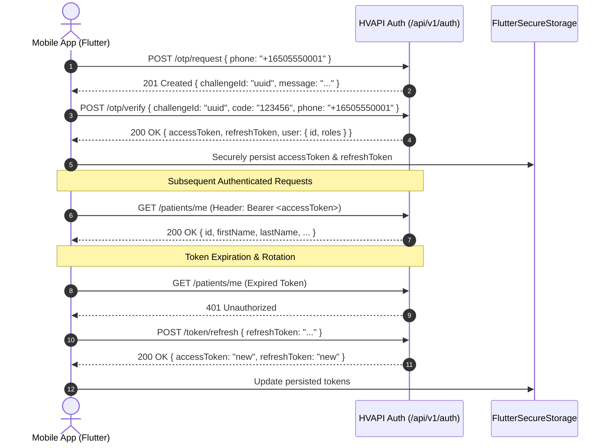

# CareID Flutter API Integration Guide

**Version:** 1.0.0  
**Target Audience:** Flutter Mobile Engineering Team (iOS & Android)  
**Backend Reference:** NestJS 11.1.28 + TypeScript 5.7 + Prisma 7.9.1 + PostgreSQL  
**Production Base URL:** `https://360api.vnvision.in/api/v1`  
**Staging Base URL:** `https://staging-api.vnvision.in/api/v1` (or local emulator)  

---

## 1. Network & Environment Setup

### 1.1 Base URLs

| Environment | Base URL | Android Emulator Target | iOS Simulator Target |
|---|---|---|---|
| **Local Development** | `http://localhost:3000/api/v1` | `http://10.0.2.2:3000/api/v1` | `http://localhost:3000/api/v1` |
| **Staging** | `https://staging-api.vnvision.in/api/v1` | `https://staging-api.vnvision.in/api/v1` | `https://staging-api.vnvision.in/api/v1` |
| **Production** | `https://360api.vnvision.in/api/v1` | `https://360api.vnvision.in/api/v1` | `https://360api.vnvision.in/api/v1` |

### 1.2 Global Request Headers

Every request from Flutter should include the following standard headers:
```http
Content-Type: application/json
Accept: application/json
Authorization: Bearer <ACCESS_TOKEN>  # Required for all protected endpoints
```
> [!NOTE]
> Native mobile apps (Flutter iOS/Android) do not send an `Origin` header. The backend CORS layer explicitly permits requests without an `Origin` header.

---

## 2. Authentication & Session Lifecycle

CareID supports phone-based OTP authentication for mobile users, password login for administrative users, and single-use JWT refresh token rotation.



### 2.1 OTP Request & Verification
1. **Request OTP:**
   - **Endpoint:** `POST /api/v1/auth/otp/request`
   - **Body:**
     ```json
     {
       "phone": "+16505550001",
       "purpose": "LOGIN"
     }
     ```
   - **Response (201 Created):**
     ```json
     {
       "challengeId": "3fa85f64-5717-4562-b3fc-2c963f66afa6",
       "message": "OTP sent successfully to registered phone number"
     }
     ```
   - *Rate Limits:* Max 3 OTP requests per phone per 10 minutes. 60-second cooldown between resends.

2. **Verify OTP:**
   - **Endpoint:** `POST /api/v1/auth/otp/verify`
   - **Body:**
     ```json
     {
       "challengeId": "3fa85f64-5717-4562-b3fc-2c963f66afa6",
       "code": "123456",
       "phone": "+16505550001"
     }
     ```
   - **Response (200 OK):**
     ```json
     {
       "accessToken": "eyJhbGciOiJIUzI1Ni...",
       "refreshToken": "eyJhbGciOiJIUzI1Ni...",
       "user": {
         "id": "c1f7a8b9-...",
         "phone": "+16505550001",
         "status": "ACTIVE",
         "roles": ["PATIENT"]
       }
     }
     ```

### 2.2 Token Refresh Flow (Dio Interceptor)
Refresh tokens are strictly single-use. The backend implements a 30-second concurrency tolerance window to handle rapid retries without invalidating the session.

```dart
class AuthInterceptor extends QueuedInterceptor {
  final Dio dio;
  final FlutterSecureStorage storage;

  AuthInterceptor(this.dio, this.storage);

  @override
  Future<void> onError(DioException err, ErrorInterceptorHandler handler) async {
    if (err.response?.statusCode == 401) {
      final refreshToken = await storage.read(key: 'refresh_token');
      if (refreshToken != null) {
        try {
          final response = await dio.post(
            '/auth/token/refresh',
            data: {'refreshToken': refreshToken},
          );
          final newAccessToken = response.data['accessToken'];
          final newRefreshToken = response.data['refreshToken'];

          await storage.write(key: 'access_token', value: newAccessToken);
          await storage.write(key: 'refresh_token', value: newRefreshToken);

          // Retry the original request
          err.requestOptions.headers['Authorization'] = 'Bearer $newAccessToken';
          final retryResponse = await dio.fetch(err.requestOptions);
          return handler.resolve(retryResponse);
        } catch (e) {
          // Token refresh failed; purge storage and route to Login screen
          await storage.deleteAll();
        }
      }
    }
    return super.onError(err, handler);
  }
}
```

---

## 3. Patient App: Verified Endpoints & Payloads

### 3.1 Patient Profile Management

#### View My Profile:
- **Endpoint:** `GET /api/v1/patients/me`
- **Response (200 OK):**
  ```json
  {
    "id": "e4b6c8a2-1111-4222-8333-555566667777",
    "userId": "c1f7a8b9-...",
    "firstName": "Alex",
    "lastName": "Johnson",
    "dateOfBirth": "1988-11-23",
    "gender": "MALE",
    "bloodGroup": "O_POSITIVE",
    "allergies": ["Penicillin", "Dust Mites"],
    "chronicConditions": ["Asthma"],
    "emergencyContactName": "Sarah Johnson",
    "emergencyContactPhone": "+16505550002",
    "emergencyContactRelation": "SPOUSE"
  }
  ```

#### Update My Profile:
- **Endpoint:** `PUT /api/v1/patients/me`
- **Body:**
  ```json
  {
    "firstName": "Alex",
    "lastName": "Johnson",
    "bloodGroup": "O_POSITIVE",
    "allergies": ["Penicillin"],
    "emergencyContactName": "Sarah Johnson",
    "emergencyContactPhone": "+16505550002",
    "emergencyContactRelation": "SPOUSE"
  }
  ```

### 3.2 Digital Health Card & QR Code

#### Get Health Card:
- **Endpoint:** `GET /api/v1/health-cards`
- **Response (200 OK):**
  ```json
  [
    {
      "id": "hc-uuid",
      "cardNumber": "CARE-2026-991823",
      "patientProfileId": "pat-profile-uuid",
      "status": "ACTIVE",
      "issuedAt": "2026-01-15T00:00:00.000Z",
      "expiresAt": "2027-01-15T00:00:00.000Z",
      "qrToken": "careid:v1:pat:3fa85f64..."
    }
  ]
  ```

#### Generate Dynamic Sharing QR Code:
- **Endpoint:** `POST /api/v1/qr/generate`
- **Body:**
  ```json
  {
    "entityType": "PATIENT_PROFILE",
    "entityId": "pat-profile-uuid",
    "validityHours": 24,
    "purpose": "EMERGENCY_ACCESS"
  }
  ```
- **Response (201 Created):**
  ```json
  {
    "id": "qr-uuid",
    "token": "careid:v1:pat:3fa85f64...",
    "qrData": "careid:v1:pat:3fa85f64...",
    "expiresAt": "2026-10-31T12:00:00.000Z",
    "status": "ACTIVE"
  }
  ```

### 3.3 Medical Records Timeline

#### Get Unified Patient Timeline:
- **Endpoint:** `GET /api/v1/medical-records/timeline`
- **Note:** Returns an unpaginated bare JSON array.
- **Response (200 OK):**
  ```json
  [
    {
      "id": "rec-101",
      "type": "RECORD",
      "title": "Comprehensive Annual Health Checkup",
      "date": "2026-08-14T09:30:00.000Z",
      "chiefComplaint": "Fatigue and mild headaches",
      "clinicalNotes": "Patient vitals within normal parameters. Advised exercise.",
      "treatmentPlan": "Increase hydration, reduce screen time.",
      "diagnoses": [
        {
          "code": "R53.83",
          "description": "Other fatigue",
          "type": "PRIMARY",
          "status": "ACTIVE"
        }
      ],
      "vitalSigns": {
        "heightCm": 178.0,
        "weightKg": 74.5,
        "systolicBp": 118,
        "diastolicBp": 78,
        "pulseBpm": 68,
        "temperatureC": 36.6
      }
    }
  ]
  ```

### 3.4 Doctor & Facility Discovery

#### Search Doctors:
- **Endpoint:** `GET /api/v1/doctors?page=1&limit=20`
- **Response (200 OK — Standard Envelope):**
  ```json
  {
    "data": [
      {
        "id": "doc-uuid-1",
        "firstName": "Robert",
        "lastName": "Chen",
        "specialization": "Cardiology",
        "registrationNumber": "MCI-2015-88492",
        "verificationStatus": "VERIFIED",
        "consultationFee": 75.00
      }
    ],
    "meta": {
      "total": 45,
      "page": 1,
      "limit": 20,
      "totalPages": 3,
      "hasNextPage": true,
      "hasPreviousPage": false
    }
  }
  ```

---

## 4. Doctor App: Verified Endpoints & Payloads

### 4.1 Obtaining Doctor Identity (Mobile Workaround)
Because there is currently no `GET /api/v1/doctors/me` route, the Doctor mobile application must resolve its `DoctorProfile.id` upon login:

```dart
Future<DoctorProfile> fetchCurrentDoctorProfile(Dio dio, String phone) async {
  // Search doctor registry using doctor's phone or name
  final response = await dio.get('/doctors/search', queryParameters: {'q': phone});
  final List doctors = response.data;
  if (doctors.isEmpty) throw Exception('Doctor profile not found in Master Registry');
  
  final doctorId = doctors.first['id'];
  // Fetch full verified profile details
  final fullProfileResponse = await dio.get('/doctors/$doctorId');
  return DoctorProfile.fromJson(fullProfileResponse.data);
}
```

### 4.2 OCR Review Workflow

#### 1. View Pending OCR Review Queue:
- **Endpoint:** `GET /api/v1/ocr/review`
- **Response (200 OK):**
  ```json
  [
    {
      "id": "ocr-job-uuid",
      "medicalAttachmentId": "att-uuid",
      "documentType": "LAB_REPORT",
      "status": "EXTRACTING",
      "overallConfidence": 0.82,
      "requiresReview": true,
      "submittedAt": "2026-10-30T07:30:00.000Z",
      "extractedFields": [
        {
          "fieldName": "hemoglobin",
          "fieldValue": "14.2 g/dL",
          "confidence": 0.78,
          "requiresReview": true
        }
      ]
    }
  ]
  ```

#### 2. Submit Verification & Corrections:
- **Endpoint:** `POST /api/v1/ocr/review/:jobId`
- **Body:**
  ```json
  {
    "corrections": [
      {
        "fieldName": "hemoglobin",
        "correctedValue": "14.2 g/dL",
        "notes": "Verified against physical paper sheet"
      }
    ],
    "verificationStatus": "VERIFIED",
    "verificationNotes": "All values verified by Dr. Chen"
  }
  ```

### 4.3 Referral Management

#### Create Outgoing Referral:
- **Endpoint:** `POST /api/v1/referrals`
- **Body:**
  ```json
  {
    "patientId": "pat-profile-uuid",
    "receivingFacilityId": "facility-uuid",
    "receivingDoctorId": "doc-uuid",
    "specialtyRequired": "Cardiology",
    "priority": "URGENT",
    "reasonForReferral": "Further evaluation for severe exertional angina",
    "clinicalSummary": "ECG reveals 2mm ST depressions in V4-V6. Troponin negative."
  }
  ```

#### View Incoming Referrals:
- **Endpoint:** `GET /api/v1/referrals/my-incoming`

---

## 5. Pagination Standards & Deserialization

The backend utilizes two different response formats for list endpoints. The Flutter team must implement flexible deserialization.

### 5.1 Standard Envelope (`{ data, meta }`)
Used by:
- `GET /api/v1/doctors`
- `GET /api/v1/facilities`
- `GET /api/v1/admin/*`
- `GET /api/v1/ocr/reviews/history`

```dart
class PaginatedResponse<T> {
  final List<T> data;
  final PaginationMeta meta;

  PaginatedResponse({required this.data, required this.meta});

  factory PaginatedResponse.fromJson(
    Map<String, dynamic> json,
    T Function(Map<String, dynamic>) fromJsonT,
  ) {
    return PaginatedResponse(
      data: (json['data'] as List).map((i) => fromJsonT(i)).toList(),
      meta: PaginationMeta.fromJson(json['meta']),
    );
  }
}

class PaginationMeta {
  final int total;
  final int page;
  final int limit;
  final int totalPages;
  final bool hasNextPage;
  final bool hasPreviousPage;

  PaginationMeta({
    required this.total,
    required this.page,
    required this.limit,
    required this.totalPages,
    required this.hasNextPage,
    required this.hasPreviousPage,
  });

  factory PaginationMeta.fromJson(Map<String, dynamic> json) => PaginationMeta(
    total: json['total'] ?? 0,
    page: json['page'] ?? 1,
    limit: json['limit'] ?? 20,
    totalPages: json['totalPages'] ?? 1,
    hasNextPage: json['hasNextPage'] ?? false,
    hasPreviousPage: json['hasPreviousPage'] ?? false,
  );
}
```

### 5.2 Bare Array Format (`List<T>`)
Used by:
- `GET /api/v1/medical-records`
- `GET /api/v1/medical-records/timeline`
- `GET /api/v1/reports`
- `GET /api/v1/notifications`
- `GET /api/v1/qr`

Parse directly as a `List<dynamic>`:
```dart
final list = (response.data as List).map((i) => Record.fromJson(i)).toList();
```

---

## 6. Standard Error Response Handling

All backend errors follow NestJS HTTP exception formatting:

```json
{
  "statusCode": 400,
  "message": "Attachment virus scan is pending or failed; download unavailable",
  "error": "Bad Request"
}
```
Or for validation errors (Class Validator):
```json
{
  "statusCode": 400,
  "message": [
    "phone must be a valid phone number",
    "purpose must be one of the following values: LOGIN, REGISTRATION, RECOVERY"
  ],
  "error": "Bad Request"
}
```

### Flutter Error Interceptor:
```dart
String extractErrorMessage(DioException err) {
  if (err.response?.data != null) {
    final data = err.response!.data;
    if (data is Map && data.containsKey('message')) {
      final msg = data['message'];
      if (msg is List) return msg.join(', ');
      if (msg is String) return msg;
    }
  }
  return err.message ?? 'An unexpected error occurred. Please try again.';
}
```

---

## 7. Features Flutter MUST NOT Call Until Phase 5

The following endpoints are either unimplemented, non-functional, or will produce breaking errors. **Do NOT wire UI actions to these endpoints in the mobile apps:**

| Endpoint / Subsystem | Current Error / Defect | Workaround / Mitigation |
|---|---|---|
| `POST /api/v1/appointment/*` | **404 Not Found** (Stubbed module) | Disable the "Book Appointment" UI tab in Flutter |
| `POST /api/v1/medical-records` by Doctors | **404 Not Found** (Resolves only patient profile) | Do not allow doctors to document encounters via mobile |
| `GET /api/v1/admin/patients/:id/medical-records` by Doctors | **403 Forbidden** (Role restricted) | Do not attempt to show clinical history to doctors |
| `GET /api/v1/reports/download/:id` for new uploads | **400 Bad Request** (`virusScanStatus: PENDING`) | Display report metadata; do not allow clicking "Download PDF" |
| Real SMS OTP in Production | **No SMS Dispatched** (Provider unconfigured) | Restrict testing to whitelisted staging test numbers |

