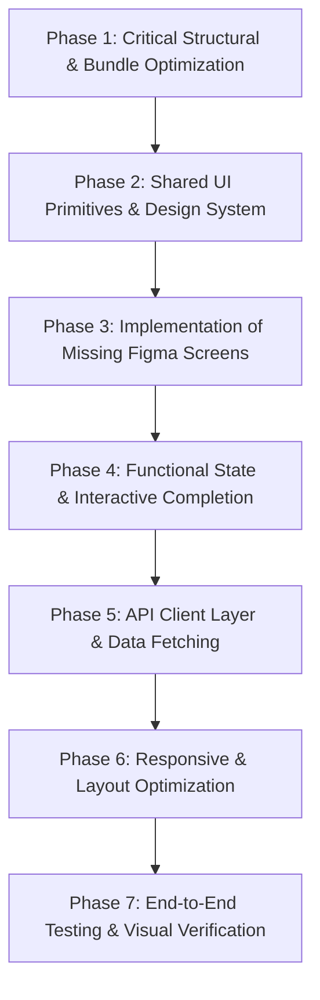

# CareID Doctor Web — Prioritized Implementation Roadmap
**Analysis Date:** November 2026  
**Target:** Production-Grade Alignment with Figma Canvas `Doctror_web` (`0:1`)  
**Standard:** Phase-Gated, File-Level Dependency Plan

---

## Roadmap Overview

---

## Phase 1: Critical Structural Issues & Bundle Optimization

### Objective
Eliminate dead code, introduce route code-splitting, reduce initial bundle size below 500 kB, and unify layout component hierarchy.

### Tasks & Affected Files
1. **Task 1.1: Route Code-Splitting with `React.lazy` & `Suspense`**
   - **Problem:** Monolithic bundle of 1,162.93 kB downloaded on every route.
   - **Action:** Convert static page imports in `src/routes/index.tsx` into dynamic `React.lazy(() => import(...))` statements with a unified clinical fallback skeleton spinner.
   - **Affected Files:** `src/routes/index.tsx`, `src/components/shared/LoadingSkeleton.tsx`
   - **Dependencies:** None
2. **Task 1.2: Remove Dead Code Layout Components**
   - **Problem:** `AppLayout.tsx`, `Header.tsx`, and `Sidebar.tsx` in `src/components/layout/` are dead code.
   - **Action:** Either delete or refactor `PatientLayout.tsx` to cleanly extract and import modular `Header` and `Sidebar` sub-components instead of inlining 500 lines.
   - **Affected Files:** `src/components/layout/PatientLayout.tsx`, `src/components/layout/Header.tsx`, `src/components/layout/Sidebar.tsx`, `src/components/layout/AppLayout.tsx`
   - **Dependencies:** Task 1.1
3. **Task 1.3: Unify Clinician Identity Across Header & Sidebar**
   - **Problem:** Header displays "Dr. Julian Vance" while sidebar card displays "Dr. Clinical Admin".
   - **Action:** Consume `useAuth()` hook in both layout sections to display synchronized clinician profile data.
   - **Affected Files:** `src/components/layout/PatientLayout.tsx`, `src/context/AuthContext.tsx`
   - **Dependencies:** Task 1.2

---

## Phase 2: Shared UI Components & Design System Primitives

### Objective
Create reusable, accessible, and token-bound UI component primitives in `src/components/shared/` to eliminate arbitrary class duplication across 40+ page files.

### Tasks & Affected Files
1. **Task 2.1: Primary Button Primitive (`Button.tsx`)**
   - **Action:** Build `<Button variant="primary" | "secondary" | "outline" | "danger" size="sm" | "md" | "lg" isLoading={...} />`. Standardize the authoritative gradient (`from-[#a44cff] to-[#5b14b8]`) and full-radius styling.
   - **Affected Files:** `src/components/shared/Button.tsx`
   - **Dependencies:** `src/lib/utils.ts`
2. **Task 2.2: Form Input & Select Primitives (`Input.tsx`, `Select.tsx`)**
   - **Action:** Build `<Input label="..." error="..." icon={...} />` and `<Select options={...} />` with keyboard navigation, focus ring (`ring-[#5b14b8]`), and error states.
   - **Affected Files:** `src/components/shared/Input.tsx`, `src/components/shared/Select.tsx`
   - **Dependencies:** None
3. **Task 2.3: Accessible Modal Dialog Primitive (`Modal.tsx`)**
   - **Action:** Build `<Modal isOpen={...} onClose={...} title="...">` with focus trap, backdrop blur (`backdrop-blur-sm`), and Esc key dismissal.
   - **Affected Files:** `src/components/shared/Modal.tsx`
   - **Dependencies:** None
4. **Task 2.4: Table, Pagination & Status Badge Primitives**
   - **Action:** Build `<Table />`, `<Pagination currentPage={...} totalPages={...} onPageChange={...} />`, and `<Badge variant="critical" | "success" | "warning" | "info" />`.
   - **Affected Files:** `src/components/shared/Table.tsx`, `src/components/shared/Pagination.tsx`, `src/components/shared/Badge.tsx`
   - **Dependencies:** None

---

## Phase 3: Missing Figma Screens Implementation

### Objective
Build the 2 completely missing Figma screens and replace generic placeholders with production code.

### Tasks & Affected Files
1. **Task 3.1: Build Prescription Builder & SOAP Note Screen (Figma `1:13265`)**
   - **Action:** Implement `ClinicalNoteCreatePage.tsx` under `src/pages/records/`. Include Chief Complaint, ICD-10 Diagnosis tags, current medications reconciliation, and multi-column Prescription Builder table with dosage, frequency, duration, and quantity inputs.
   - **Route Binding:** Update `/records/new` in `src/routes/index.tsx` from `PlaceholderPage` to `<ClinicalNoteCreatePage />`.
   - **Affected Files:** `src/pages/records/ClinicalNoteCreatePage.tsx`, `src/routes/index.tsx`, `src/pages/records/types.ts`
   - **Dependencies:** Phase 2 (Button, Input, Select, Table)
2. **Task 3.2: Build Treatment Offer Lifecycle Master Timeline (Figma `1:8548`)**
   - **Action:** Implement `TreatmentOfferLifecyclePage.tsx` under `src/pages/treatment-offers/`. Render the 18-step interactive visual pipeline with patient biometrics summary card (Robert J. Sterling #8472-9901), milestone status badges, and clickable step navigation.
   - **Route Binding:** Update `/treatment-offers` in `src/routes/index.tsx` from `PlaceholderPage` to `<TreatmentOfferLifecyclePage />`.
   - **Affected Files:** `src/pages/treatment-offers/TreatmentOfferLifecyclePage.tsx`, `src/routes/index.tsx`, `src/pages/treatment-offers/types.ts`
   - **Dependencies:** Phase 2 (Badge, Button)
3. **Task 3.3: Build Dedicated Search No Results Screen (Figma `1:745`)**
   - **Action:** Build `SearchNoResultsView.tsx` matching Figma frame `1:745` with active query chips, illustration, bulleted search suggestions, and "Clear Filters" action.
   - **Affected Files:** `src/pages/patients/SearchNoResultsView.tsx`, `src/pages/patients/PatientDirectoryPage.tsx`
   - **Dependencies:** Phase 2
4. **Task 3.4: Build Dedicated Login & OTP Pages**
   - **Action:** Replace generic `AuthPlaceholder.tsx` with dedicated `LoginPage.tsx` matching Figma `1:2`. Cleanly separate layout from form logic.
   - **Affected Files:** `src/pages/auth/LoginPage.tsx`, `src/components/layout/OtpLayout.tsx`, `src/routes/index.tsx`
   - **Dependencies:** Phase 2

---

## Phase 4: Functional Implementation & State Architecture

### Objective
Establish cross-page state persistence for clinical workflows, activate broken controls, and add working countdown timers and search listeners.

### Tasks & Affected Files
1. **Task 4.1: Treatment Offer & Procedure Lifecycle Context Store**
   - **Action:** Create `TreatmentOfferContext.tsx` storing active proposal details, CPT codes, selected Cath Lab slot, pre-op clearance checks, and surgical encounter telemetry so data persists across the 18 steps.
   - **Affected Files:** `src/context/TreatmentOfferContext.tsx`, `src/pages/treatment-offers/*`, `src/pages/cath-lab/*`
   - **Dependencies:** Phase 3
2. **Task 4.2: Connect Global Search Bar**
   - **Action:** Implement controlled input state with debounced search listener in top header; dispatch search queries to filter `PatientDirectoryPage` or display quick-result dropdown.
   - **Affected Files:** `src/components/layout/PatientLayout.tsx`, `src/pages/patients/PatientDirectoryPage.tsx`
   - **Dependencies:** Phase 2
3. **Task 4.3: Implement Working Table Pagination & Multi-Column Sorting**
   - **Action:** Connect `Pagination` primitive to slice patient lists, medical records, and referrals dynamically with items-per-page selectors (10, 25, 50).
   - **Affected Files:** `src/pages/patients/PatientDirectoryPage.tsx`, `src/pages/records/MedicalRecordsPage.tsx`, `src/pages/referrals/ReferralDashboardPage.tsx`
   - **Dependencies:** Phase 2
4. **Task 4.4: Interactive OTP Timer & Resend Cooldown**
   - **Action:** Add a 28-second active countdown interval in `OtpLayout.tsx`; disable "Resend OTP" button during countdown; re-enable on 00:00 with simulated SMS dispatch toast.
   - **Affected Files:** `src/components/layout/OtpLayout.tsx`
   - **Dependencies:** Phase 2
5. **Task 4.5: Quick Action Modals on Dashboard**
   - **Action:** Implement `AddPatientModal` and `QuickScheduleModal` triggered by "Add New Patient" and "Schedule Appointment" buttons on Dashboard.
   - **Affected Files:** `src/pages/DashboardPage.tsx`, `src/components/shared/Modal.tsx`
   - **Dependencies:** Phase 2

---

## Phase 5: API Client Layer & Data Fetching Architecture

### Objective
Structure data fetching interfaces and separate mock datasets from UI components in preparation for backend integration.

### Tasks & Affected Files
1. **Task 5.1: API Service Layer & Typed Contracts**
   - **Action:** Create `src/services/` with modular API client modules:
     - `authService.ts`: login, verifyOtp, logout
     - `patientService.ts`: getPatients, getPatientById, updatePatient
     - `recordsService.ts`: getRecords, createRecord, uploadDocument
     - `procedureService.ts`: getOfferLifecycle, updateSlot, sealEncounter
     - `referralService.ts`: getReferrals, dispatchReferral, acceptReferral
   - **Affected Files:** `src/services/*`, `src/types/*`
   - **Dependencies:** None
2. **Task 5.2: Mock Service Worker (MSW) or Fallback Client Adapters**
   - **Action:** Implement client-side service adapters that read from `localStorage` or memory, allowing full offline testing with realistic asynchronous network latency (200ms–500ms).
   - **Affected Files:** `src/services/adapters/*`
   - **Dependencies:** Task 5.1

---

## Phase 6: Responsive & Layout Optimization

### Objective
Fix canvas width clipping, mobile table overflows, and modal accessibility.

### Tasks & Affected Files
1. **Task 6.1: Wide Screen Layout for Medical Records (1576px Support)**
   - **Action:** Allow `MedicalRecordsPage` and `ClinicalNoteCreatePage` to expand beyond `1440px` to the Figma-specified `1576px` on ultra-wide clinician monitors while maintaining clean horizontal scrolling on smaller laptops.
   - **Affected Files:** `src/components/layout/PatientLayout.tsx`, `src/pages/records/MedicalRecordsPage.tsx`
   - **Dependencies:** Phase 3
2. **Task 6.2: Responsive Card Fallbacks for Tables**
   - **Action:** Render mobile-friendly vertical summary cards for patient directories and lab panels on viewports <768px.
   - **Affected Files:** `src/pages/patients/PatientDirectoryPage.tsx`, `src/pages/records/LabReportPage.tsx`
   - **Dependencies:** Phase 2
3. **Task 6.3: Cath Lab Viewport Resolution Guards**
   - **Action:** Add non-blocking responsive warning banner when Cath Lab surgical workstation is viewed on screens narrower than 1024px.
   - **Affected Files:** `src/pages/cath-lab/*`
   - **Dependencies:** Phase 4

---

## Phase 7: Final Testing & Visual Verification

### Objective
Verify complete pixel-level and functional parity against all 48 Figma screens.

### Tasks & Affected Files
1. **Task 7.1: Visual Regression Comparison**
   - Verify every screen against its Figma frame token-by-token (colors, typography, padding, radii, elevation).
2. **Task 7.2: End-to-End Workflow Validation**
   - Test full user journey: Login -> OTP -> Dashboard -> Patient Profile -> Create Treatment Offer -> Financing -> Schedule Slot -> Pre-Op Checklist -> Cath Lab Encounter -> Post-Op Attestation.
3. **Task 7.3: TypeScript & Lint Verification**
   - Ensure `npm run type-check`, `npm run lint`, and `npm run build` execute cleanly with zero errors or warnings.

