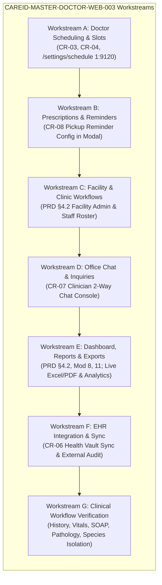

# CAREID DOCTOR WEB — MASTER GOAL 003 IMPLEMENTATION PLAN

**Document ID:** CAREID-PLAN-DOCWEB-003-MASTER  
**Date:** November 21, 2026  
**Auditor / Lead Engineer:** Antigravity Senior Principal Systems & Regulatory Compliance Engineer  
**Project:** CAREID — HEALTH VAULT 360  
**Master Goal:** CAREID-MASTER-DOCTOR-WEB-003  
**Priority:** P0 — DOCTOR WEB COMPLETION  
**Authorization Status:** **GRANTED FOR VERIFIED CLIENT-REQUIRED GAPS**  

---

## 1. Master Objective & Execution Principles

This implementation plan governs the end-to-end execution of `CAREID-MASTER-DOCTOR-WEB-003`. Building directly upon the foundation established in Batches 1–3 and the forensic gap analysis from `CAREID-MASTER-DOCTOR-WEB-002`, this goal completes all verified client-required Doctor Web features.

### Core Non-Negotiable Rules:
1. **Preserve Existing UI/UX Baseline**: Maintain the current Doctor Web design, navigation, typography, colors, spacing, and shared component system. Connect existing placeholders, controls, and routes to real backend functionality without redesigning screens or creating secondary design systems.
2. **End-to-End Vertical Slices**: Every completed feature must operate through:
   $$\text{Doctor Web UI} \longrightarrow \text{Frontend API Service} \longrightarrow \text{NestJS Backend} \longrightarrow \text{Prisma ORM} \longrightarrow \text{PostgreSQL} \longrightarrow \text{Updated Doctor Web UI}$$
3. **Repository Ownership & Boundary Controls**:
   - Authorized code modifications: `D:\careid\doctor_web` and `D:\careid\backend`.
   - Read-only: `D:\careid\Admin_web`.
   - Strictly forbidden: Modifying Developer 2's Flutter applications (`CAREID_doctor_app`, `CAREID_patient_app`).
4. **Strict Species Isolation**: Preserve Option A dual-workspace separation (`HUMAN_DOCTOR` vs. `VETERINARIAN`). Fail-closed authorization at all endpoints.
5. **Cath Lab & Unconfirmed Modules Policy**: Cath Lab surgical documentation suites remain descoped as dormant assets; zero expansion into acute-care intra-op systems.

---

## 2. Workstream Breakdown & Scope Mapping

---

## 3. Workstream Detailed Specifications

### Workstream A: Doctor Scheduling and Appointments (CR-03, CR-04)
- **Problem Statement**: The route `/settings/schedule` currently displays `PlaceholderPage` (`1:9120`). Clinicians have no UI to manage weekly working hours, set slot duration, block time-offs, or review vacant slots identified by the scheduling engine.
- **Implementation Tasks**:
  1. Create `doctor_web/src/services/scheduleService.ts` wiring to backend `ScheduleController`.
  2. Create `doctor_web/src/pages/settings/ScheduleManagementPage.tsx` matching Doctor Web styling:
     - Weekly availability grid (Monday–Sunday) with active toggles and shift start/end time pickers.
     - Slot duration selector (`15`, `30`, `45`, `60` minutes) and buffer time controls.
     - Vacation / clinic block-out date picker.
     - Vacant / cancelled slot identification list with quick booking or offer triggers (CR-03).
  3. Update `doctor_web/src/routes/index.tsx` to replace `PlaceholderPage` with `ScheduleManagementPage`.
  4. Ensure PostgreSQL persistence via `doctor_schedule_slots` and `generated_slots`.

### Workstream B: Prescriptions and Reminders (CR-08)
- **Problem Statement**: Batch 2 delivered prescription creation and PDF export, but lacks the clinician-facing toggle and interval configuration for automated patient pickup reminders mandated in CR-08.
- **Implementation Tasks**:
  1. Add schema migration to `Prescription` model:
     - `pickupReminderEnabled`: Boolean (default `false`)
     - `pickupReminderHours`: Int (default `2`)
  2. Update backend `PrescriptionDto`, `CreatePrescriptionDto`, and service layer to persist reminder attributes.
  3. Update `doctor_web/src/pages/records/PrescriptionsPage.tsx`:
     - Add "Patient Pickup Reminder" checkbox to `CreatePrescriptionModal`.
     - Add reminder interval dropdown (`1 hour`, `2 hours`, `4 hours`, `12 hours`, `24 hours post-consultation`).
     - Display pickup reminder badge in prescription table and detail drawer.
  4. Verify PostgreSQL persistence in `prescriptions`.

### Workstream C: Facility and Clinic Workflows (PRD §4.2)
- **Problem Statement**: PRD §4.2 (p. 6, 18) specifies that Doctors can assign Facility Admins, and Facility Admins can add/deactivate staff. Currently, no UI exists in Doctor Web for this.
- **Implementation Tasks**:
  1. Implement `doctor_web/src/pages/facilities/FacilityManagementPage.tsx`:
     - Display affiliated facility cards with address, phone, and role badge.
     - Facility Admin designation dropdown for doctors.
     - Staff roster table with role badges (`Nurse`, `Receptionist`, `Staff`).
     - "Add Staff" modal submitting to backend with status `PENDING_APPROVAL` (per PRD mandate).
  2. Wire to `doctor_web/src/services/facilityService.ts` and backend `FacilityController`.
  3. Register route `/facilities` in `doctor_web/src/routes/index.tsx` and add navigation link in Sidebar.

### Workstream D: Office Chat and Patient Inquiries (CR-07)
- **Problem Statement**: CR-07 requires a 2-way communication console between patients and the clinic office. Backend `MessagingController` exists, but Doctor Web lacks a frontend UI.
- **Implementation Tasks**:
  1. Create `doctor_web/src/services/chatService.ts` connecting to `MessagingController`.
  2. Implement `doctor_web/src/pages/communication/OfficeChatConsolePage.tsx`:
     - Conversation list with unread inquiry indicators and patient badges.
     - Active chat pane with message history and timestamped bubbles.
     - Quick-reply template selector for common clinic responses (hours, directions, prep).
     - Message input with enter-to-send and character counter.
  3. Register route `/communication/chat` in `doctor_web/src/routes/index.tsx`.

### Workstream E: Dashboard, Reports and Exports (PRD §4.2, Mod 8, Mod 11)
- **Problem Statement**: Dashboard export buttons are inactive, and `/reports/outcomes` (`1:7120`) and `/reports/exports` (`1:7230`) render placeholders.
- **Implementation Tasks**:
  1. Wire Dashboard "Export Excel" and "Export PDF" buttons in `DashboardPage.tsx` to streaming report endpoints.
  2. Implement `doctor_web/src/pages/reports/ClinicalOutcomesPage.tsx`:
     - Aggregated outcome charts (treatment completion, follow-up adherence, appointment volume).
  3. Implement `doctor_web/src/pages/reports/AuditExportCenterPage.tsx`:
     - HIPAA audit log table with date/action filters and CSV export trigger.
  4. Update `/reports/outcomes` and `/reports/exports` in `doctor_web/src/routes/index.tsx`.

### Workstream F: EHR Integration and Synchronization (CR-06)
- **Problem Statement**: CR-06 requires bi-directional EHR synchronization. Internal records are synchronized, but clinicians have no interface to inspect synchronization health, last-synced timestamps, or external FHIR status.
- **Implementation Tasks**:
  1. Implement `doctor_web/src/pages/settings/EhrIntegrationPage.tsx`:
     - Internal Health Vault sync status card (Active, auto-synced).
     - Connected external health systems section (noting external provider contract status as `BLOCKED_EXTERNAL_DEPENDENCY` since client has not provided external hospital FHIR endpoint).
     - Sync audit log table showing historical synchronization events.
  2. Add route `/settings/ehr` in `doctor_web/src/routes/index.tsx`.

### Workstream G: Cross-Module Verification & Species Isolation
- **Verification Protocol**:
  1. Run automated test suite verifying all 49 requirements.
  2. Execute real Chromium browser tests for all completed workflows.
  3. Validate PostgreSQL writes on port 5433.
  4. Ensure zero regression to Batches 1–3.

---

## 4. Execution Checkpoints & Deliverables Schedule

| Step | Phase | Deliverables Produced | Verification Gate |
| :---: | :--- | :--- | :--- |
| **0** | Baseline & Safety | Health checks, ports 3001/5173/5433, 35/35 test baseline | **PASS** |
| **1** | Workstream A & B | `ScheduleManagementPage.tsx`, `PrescriptionsPage.tsx` reminder modal, backend migration | Automated tests + PostgreSQL persistence |
| **2** | Workstream C & D | `FacilityManagementPage.tsx`, `OfficeChatConsolePage.tsx`, service layers | Automated tests + PostgreSQL persistence |
| **3** | Workstream E & F | Dashboard exports, `ClinicalOutcomesPage.tsx`, `AuditExportCenterPage.tsx`, `EhrIntegrationPage.tsx` | Automated tests + Export validation |
| **4** | Cross-Module E2E | Browser automated run with screenshots | Real Chromium verification |
| **5** | Final Acceptance | 8 required documentation artifacts in `doctor_web/docs/` | Complete sign-off |
