# CAREID DOCTOR WEB — OUT OF SCOPE AND UNCONFIRMED FEATURES REPORT

**Document ID:** CAREID-REPORT-DOCWEB-002-OOS  
**Date:** November 21, 2026  
**Auditor:** Antigravity Senior Principal Systems & Regulatory Compliance Auditor  
**Project:** CAREID — HEALTH VAULT 360  
**Master Goal:** CAREID-MASTER-DOCTOR-WEB-002  

---

## 1. Executive Summary

This report establishes the definitive operational and contractual boundaries for the CareID Doctor Web platform. A primary risk identified during the forensic audit of the codebase was **uncontrolled scope expansion**—specifically the implementation of hyper-specialized clinical, retail, and laboratory sub-systems that were neither requested in the client PRD (`HEALTH VAULT 360.pdf`) nor approved in the Change Request Register (`Care ID_ CR Sheet.xlsx`).

This document formally details each out-of-scope or unconfirmed feature, provides contractual justification, and establishes the strict boundaries governing future development.

---

## 2. In-Scope vs. Out-of-Scope Functional Matrices

### 2.1 Prescriptions vs. Pharmacy Management

| In-Scope (Doctor Web Outpatient Scope) | Out-of-Scope (Pharmacy Operations) | Contractual Justification |
| :--- | :--- | :--- |
| **Electronic Prescription Creation**: Clinicians specify medication name, dosage, form, route, frequency, duration, and instructions. | **Pharmacy Drug Inventory**: Stock levels, lot tracking, warehouse storage conditions, reorder triggers. | CareID is a patient-facing Health Vault and clinical documentation tool, not an Enterprise Resource Planning (ERP) or Pharmacy Management System (PMS). |
| **Encounter & Patient Linkage**: Prescriptions are linked to patient profiles and encounter diagnoses. | **Point-of-Sale (POS) & Billing**: Payment collection, retail markups, copay calculation, cashier drawers. | Commercial retail transactions are out of scope. |
| **Prescription PDF Generation**: Downloadable binary PDF with clinic header, prescriber license, and digital stamp. | **Dispensing Operations**: Pill counting, bottle labeling, barcode verification of stock bottles. | Dispensing is governed by licensed pharmacy software, not clinician portals. |
| **Status Lifecycle**: Tracking status (`ACTIVE`, `DISCONTINUED`, `EXPIRED`, `REFILLED`). | **Supplier & Wholesaler Management**: Purchase orders, vendor contracts, wholesale invoices. | Supply chain workflows are strictly excluded. |
| **Pickup Reminders (CR-08)**: Triggering automated patient notifications to collect medication. | **Pharmacy Staff Portal**: Dedicated login, queue management, and shift tracking for pharmacy clerks. | Pharmacy staff are not an authorized actor in `HEALTH VAULT 360.pdf` (p. 25). |

### 2.2 Diagnostics vs. Laboratory Management

| In-Scope (Doctor Web Outpatient Scope) | Out-of-Scope (Laboratory Workflow) | Contractual Justification |
| :--- | :--- | :--- |
| **Medical Document & Scan Uploads**: Clinicians and patients upload PDFs, JPGs, and X-ray images. | **Specimen Collection & Accessioning**: Barcode printing for blood tubes, specimen accessioning logs. | Specimen tracking requires a Laboratory Information Management System (LIMS), which is not part of CareID. |
| **Report Access & Viewing**: Clinicians review pathology and lab reports, view flag indicators (Normal, High, Panic). | **Laboratory Machine Ingestion**: Interfacing with hematology or chemistry analyzers (ASTM/HL7). | Direct laboratory instrument telemetry is unconfirmed and out of scope. |
| **Historical Results Tracking**: Longitudinal tracking of vitals, blood panels, and metabolic panels. | **Technician Workflows & Result Entry**: Lab tech entry screens, reagent batch lot tracking, control runs. | Laboratory personnel are not among the approved user roles in the PRD. |
| **Critical Value Review (Figma `1:3732`)**: Panic alert notification banner requiring clinician acknowledgment. | **Laboratory Billing & Requisition**: Generating CMS-1500 lab billing claims. | Billing is handled by institutional revenue cycle systems. |

### 2.3 Human vs. Veterinary Clinical Care

| Workspace Parameter | Human Healthcare (`HUMAN_DOCTOR`) | Veterinary Care (`VETERINARIAN`) |
| :--- | :--- | :--- |
| **Workspace Route** | `/dashboard`, `/patients`, `/records`, `/treatment-offers` | `/veterinary/dashboard`, `/veterinary/pets`, `/pets/:id` |
| **Subject Entity** | `PatientProfile` (SSN, national ID, DOB, human history) | `Pet` (Microchip ID, species, breed, owner link) |
| **Clinical Records** | SOAP notes, human vitals (BP, BMI, SpO2), human prescriptions | Pet clinical notes, species-specific vitals, pet vaccinations |
| **Vaccine Regimen** | Human immunizations (MMR, COVID, Tdap) | Pet vaccinations (Rabies, DHPP, Bordetella, FVRCP) |
| **Access Control** | Enforces patient consent, facility affiliation, human license | Enforces owner consent, veterinary license |
| **Isolation Policy** | **Strict Separation**: Zero cross-workspace navigation, zero shared clinical models, fail-closed access. |

### 2.4 QR Scanning Architecture

| Feature | Allocation | Architectural Decision |
| :--- | :--- | :--- |
| **Camera-Based QR Scanner** | Developer 2 Flutter App (`CAREID_doctor_app`) | **Excluded from Doctor Web**. WebRTC camera permissions, browser video capture, and client QR decoders are not implemented in Doctor Web. |
| **Patient Profile Search & URL Routing** | CareID Doctor Web (`doctor_web`) | **Retained in Doctor Web**. Clinicians search the patient directory or navigate directly to `/patients/:id` after QR verification. |
| **QR Signature Verification API** | CareID Backend (`src/modules/qr`) | **Shared Backend Service**. Exposes `POST /api/v1/qr/verify` to validate QR signatures, log verification audits, and resolve patient identifiers. |

---

## 3. Unconfirmed Subsystems & Future Descoping Candidates

### 3.1 Dental and Vision Modules
- **Findings in Codebase**:
  * Backend contains `src/modules/dental` and `src/modules/vision`.
  * Prisma schema contains `DentalRecord` and `VisionRecord` models.
- **Contractual Status**:
  * Neither `HEALTH VAULT 360.pdf` nor `Care ID_ CR Sheet.xlsx` mention specialized Dental Odontograms or Vision Refraction charts.
  * These modules represent unconfirmed future enhancements.
- **Audit Decision**:
  * Retain backend models as dormant tables.
  * **Do NOT implement specialized Dental or Vision UI screens** in Doctor Web. Outpatient clinical documentation must rely on the unified `MedicalRecord` and `ClinicalDiagnosis` models.

### 3.2 Hyper-Specialized Surgical & Procedure Suites (Cath Lab)
- **Findings in Codebase**: 5 dedicated pages, 21 backend endpoints, telemetry logging, QCA vessel calculations.
- **Contractual Status**: **Unconfirmed Scope Expansion** (derived from illustrative Figma demo frames `1:10786` to `1:16047`).
- **Audit Decision**: Fully detailed in `DOCTOR_WEB_CATH_LAB_SCOPE_VERIFICATION.md`. Descope from production outpatient batches.

---

## 4. Contractual Scope Matrix Summary

```mermaid
flowchart TD
    subgraph Approved_Doctor_Web_Scope["Approved Doctor Web Scope (PRD + CR-02..08)"]
        direction TB
        A1["Doctor OTP Auth & Dual-Role Gate"]
        A2["Doctor Dashboard & Metric Filtering"]
        A3["Patient Directory & Profile Search"]
        A4["Longitudinal History & Vitals"]
        A5["SOAP Notes & Pathology Review"]
        A6["Electronic Prescriptions & PDF Export"]
        A7["Referral Triage & PDF Export"]
        A8["Treatment Offers & Financing (CR-02)"]
        A9["Doctor Schedule & Slot Config (CR-03, CR-04)"]
        A10["Prescription Pickup Reminder (CR-08)"]
        A11["Facility Admin & Staff Assignment (PRD §4.2)"]
        A12["2-Way Office Chat Console (CR-07)"]
        A13["Clinical Outcomes & Audit Export (Mod 11)"]
        A14["Isolated Veterinary Vault (Batch 3)"]
    end

    subgraph Out_Of_Scope_Excluded["Excluded / Out-of-Scope Subsystems"]
        direction TB
        O1["Camera QR Scanning (Flutter Only)"]
        O2["Pharmacy Inventory, POS & Retail Sales"]
        O3["Laboratory Specimen Logging & Analyzer Telemetry"]
        O4["Cath Lab Fluoroscopy & Intra-Op Notes"]
        O5["Specialized Dental Odontogram Screens"]
        O6["Full SuperAdmin System Governance"]
    end
```

---

## 5. Scope Governance Directive

1. **No Out-of-Scope Features**: Any pull request or batch proposal attempting to implement pharmacy inventory, laboratory analyzer interfaces, or camera QR scanning must be rejected.
2. **Focus on Core Outpatient Delivery**: All remaining engineering effort must be directed solely toward the 5 confirmed missing/partial outpatient requirements.
