# CAREID DOCTOR WEB — REMAINING IMPLEMENTATION ROADMAP

**Document ID:** CAREID-ROADMAP-DOCWEB-002-PLAN  
**Date:** November 21, 2026  
**Auditor:** Antigravity Senior Principal Systems & Regulatory Compliance Auditor  
**Project:** CAREID — HEALTH VAULT 360  
**Master Goal:** CAREID-MASTER-DOCTOR-WEB-002  
**Implementation Authorization:** **NOT GRANTED**  
**Execution Policy:** **STRICT SEQUENTIAL BATCHING WITH CLIENT GATES**  

---

## 1. Executive Summary

This roadmap establishes the final, definitive execution plan to bring the CareID Doctor Web application to 100% production completeness against the client-approved PRD (`HEALTH VAULT 360.pdf`) and Change Request register (`Care ID_ CR Sheet.xlsx`).

Having completed Batches 1, 2, and 3, and formally descoped unapproved Cath Lab surgical suites, the remaining client scope is consolidated into **three focused, self-contained development batches**:

```mermaid
flowchart LR
    B13["Batches 1–3<br>(Accepted Core)"] --> Gate4["Client Approval<br>Gate 4"]
    Gate4 --> B4["Batch 4: Schedule, Slots &<br>Prescription Reminders"]
    B4 --> Gate5["Client Acceptance &<br>Approval Gate 5"]
    Gate5 --> B5["Batch 5: Facility Mgmt &<br>Office Chat"]
    B5 --> Gate6["Client Acceptance &<br>Approval Gate 6"]
    Gate6 --> B6["Batch 6: Clinical Reports,<br>Exports & EHR Sync"]
    B6 --> Final["Final Cross-Platform<br>Doctor Web Complete"]
```

---

## 2. Batch 4: Doctor Schedule & Slot Availability Management + Prescription Pickup Reminders

### 2.1 Batch Objectives
1. Provide doctors with a functional weekly availability scheduler and slot configuration interface, eliminating the placeholder at `/settings/schedule`.
2. Connect Doctor Web to backend slot optimization and vacant/cancelled slot identification (CR-03, CR-04).
3. Extend the electronic prescription issuance modal with an automated patient pickup reminder toggle and reminder hours selector (CR-08).

### 2.2 In-Scope Requirements
- **CR-03-SLOT-01**: AI-enabled identification and listing of vacant/cancelled appointment slots.
- **CR-04-APPT-01**: Doctor working hours configuration, recurring weekly availability, slot duration, and buffer time controls.
- **CR-08-REM-01**: Clinician configuration for prescription pickup reminders (enable/disable checkbox, reminder hours dropdown, notification dispatch linkage).

### 2.3 Out-of-Scope Boundaries
- Public patient booking portal (handled by Developer 2 Flutter Patient App).
- Cath Lab intra-operative procedure documentation (descoped).

### 2.4 Technical Architecture & Component Breakdown

| Tier | Component / File | Purpose & Action |
| :--- | :--- | :--- |
| **Frontend UI** | `doctor_web/src/pages/settings/ScheduleManagementPage.tsx` | **NEW Component**: Interactive weekly calendar grid (Monday–Sunday), shift time pickers, slot duration selector (15/30/45/60 min), vacation block-out dates, vacant slot list. |
| **Frontend Routing** | `doctor_web/src/routes/index.tsx` | Replace `PlaceholderPage` at `/settings/schedule` with `ScheduleManagementPage`. |
| **Frontend UI** | `doctor_web/src/pages/records/PrescriptionsPage.tsx` | Add "Prescription Pickup Reminder" configuration section to `CreatePrescriptionModal` with hours selector (`1h`, `2h`, `4h`, `12h`, `24h`). |
| **Frontend Service** | `doctor_web/src/services/scheduleService.ts` | **NEW Service**: Client methods `getDoctorSchedule()`, `updateWorkingHours()`, `generateSlots()`, `getVacantSlots()`. |
| **Backend API** | `backend/src/modules/schedule/schedule.controller.ts` | Wire existing endpoints: `GET /api/v1/schedule/doctor/me`, `POST /api/v1/schedule/slots`, `GET /api/v1/schedule/vacant-slots`. |
| **Database Model** | `backend/prisma/schema.prisma` | Add `pickupReminderEnabled` (Boolean default false) and `pickupReminderHours` (Int default 2) to model `Prescription`. |
| **DB Migration** | `backend/prisma/migrations/` | Create safe migration `add_prescription_pickup_reminder`. |

### 2.5 Acceptance Criteria
- Clinician can navigate to `/settings/schedule`, adjust Monday–Friday working hours (e.g. 09:00–17:00), save, refresh page, and verify persisted slot schedule.
- Clinician can view vacant appointment slots identified by the scheduling engine.
- Clinician can issue a prescription with pickup reminder enabled (e.g. 2 hours), verify values are written to PostgreSQL `prescriptions` table, and confirm scheduled notification job is created.

---

## 3. Batch 5: Facility Management & Administrative Delegation + 2-Way Office Communication

### 3.1 Batch Objectives
1. Implement the clinician Facility Management interface mandated in PRD §4.2 (p. 6, 18), enabling doctors to view affiliated facilities, assign Facility Admins, and manage facility staff.
2. Implement the 2-way office chat console (CR-07), allowing clinicians and clinic staff to respond to patient inquiries and configure quick-reply templates.

### 3.2 In-Scope Requirements
- **PRD-FAC-01**: Doctor assignment of Facility Admin for affiliated clinical locations.
- **PRD-FAC-02**: Facility Admin management of doctors and staff (add, edit, deactivate, submit for SuperAdmin approval).
- **CR-07-CHAT-01**: Clinician 2-way messaging console, inquiry queue, real-time message exchange, template quick-replies.

### 3.3 Out-of-Scope Boundaries
- SuperAdmin platform-wide facility licensing (handled by Admin Web).
- Marketing or billing inquiries (out of scope).

### 3.4 Technical Architecture & Component Breakdown

| Tier | Component / File | Purpose & Action |
| :--- | :--- | :--- |
| **Frontend UI** | `doctor_web/src/pages/facilities/FacilityManagementPage.tsx` | **NEW Component**: Facility switcher, Facility Admin assignment card, Staff roster with role badges, Add Staff modal with SuperAdmin approval warning. |
| **Frontend UI** | `doctor_web/src/pages/communication/OfficeChatConsolePage.tsx` | **NEW Component**: Patient message thread list, unread message badges, real-time message view, quick-reply template selector, rich text inquiry responses. |
| **Frontend Routing** | `doctor_web/src/routes/index.tsx` | Add routes `/facilities` and `/communication/chat`. |
| **Frontend Service** | `doctor_web/src/services/facilityService.ts` | Wire to `FacilityManagementPage.tsx` (`getFacilities()`, `assignFacilityAdmin()`, `addFacilityStaff()`). |
| **Frontend Service** | `doctor_web/src/services/chatService.ts` | **NEW Service**: Wire to backend `MessagingController` (`listConversations()`, `getMessages()`, `sendMessage()`, `getTemplates()`). |
| **Backend API** | `backend/src/modules/facility/` & `messaging/` | Expose `GET /api/v1/facilities/my-facilities`, `POST .../staff`, `GET /api/v1/messaging/conversations`, `POST .../messages`. |
| **Database Model** | `Facility`, `DoctorFacility`, `FacilityStaff`, `Conversation`, `DirectMessage` | Models already exist in Prisma schema; zero new migrations required. |

### 3.5 Acceptance Criteria
- Doctor can view affiliated facilities, select a facility, and assign an eligible user as Facility Admin.
- Facility Admin can invite a staff member, and record is saved with status `PENDING_APPROVAL`.
- Doctor can receive a patient chat inquiry, view message history, select a template quick-reply, send response, and verify message persistence in PostgreSQL `direct_messages`.

---

## 4. Batch 6: Advanced Clinical Reports, PDF/Excel Exports & Bi-Directional EHR Sync

### 4.1 Batch Objectives
1. Replace placeholder pages at `/reports/outcomes` and `/reports/exports` with functional clinical analytics, outcome metrics, and audit log inspection.
2. Implement live PDF and Excel export streaming on the main Doctor Dashboard and Reports Center (PRD §4.2, Module 11).
3. Implement the Bi-Directional EHR synchronization status monitor and external sync audit trail (CR-06).

### 4.2 In-Scope Requirements
- **PRD-DASH-03**: Dashboard report downloads in Excel (.xlsx) and PDF format.
- **PRD-REP-02**: Clinical outcomes dashboard (treatment efficacy, readmission rates, encounter volume).
- **PRD-REP-03**: Custom dataset export and HIPAA access audit log viewer/exporter.
- **CR-06-EHR-01**: Bi-directional EHR synchronization monitor, showing last synchronized timestamps, external system status (FHIR/HL7), and manual sync triggers.

### 4.3 Technical Architecture & Component Breakdown

| Tier | Component / File | Purpose & Action |
| :--- | :--- | :--- |
| **Frontend UI** | `doctor_web/src/pages/reports/ClinicalOutcomesPage.tsx` | **NEW Component**: Replaces `/reports/outcomes` placeholder. Efficacy metrics, condition improvement rates, encounter distribution. |
| **Frontend UI** | `doctor_web/src/pages/reports/AuditExportCenterPage.tsx` | **NEW Component**: Replaces `/reports/exports` placeholder. HIPAA audit log filter, CSV/Excel export builder, generated export download table. |
| **Frontend UI** | `doctor_web/src/pages/settings/EhrIntegrationPage.tsx` | **NEW Component**: Connected health systems list, last sync timestamp, record count, manual sync button, synchronization audit history. |
| **Frontend UI** | `doctor_web/src/pages/DashboardPage.tsx` | Connect "Export PDF" and "Export Excel" buttons to live streaming export handlers. |
| **Backend API** | `backend/src/modules/reports/` | Expose `GET /api/v1/reports/dashboard/export?format=pdf\|xlsx`, `GET /api/v1/reports/outcomes`, `GET /api/v1/audit/logs/export`. |
| **Database Model** | `ReportDefinition`, `GeneratedReport`, `AuditLog`, `RecordShareGrant` | Models already exist in Prisma schema. |

### 4.4 Acceptance Criteria
- Clicking "Export Excel" on Dashboard downloads a valid `.xlsx` spreadsheet containing authentic consultation metrics.
- Clicking "Export PDF" on Dashboard downloads a valid `.pdf` report with CareID branding.
- Clinician can view the HIPAA audit log, apply date filters, and export to CSV.
- Clinician can view EHR sync status and trigger manual sync, with result reflected in PostgreSQL.

---

## 5. Sequential Execution Schedule & Approval Gates

| Batch | Title | Scope Summary | Prerequisite | Estimated Effort | Client Gate |
| :---: | :--- | :--- | :---: | :---: | :---: |
| **Batch 4** | Schedule, Slots & Prescription Reminders | Weekly availability editor (`/settings/schedule`), vacant slots (CR-03, CR-04), prescription pickup reminder (CR-08). | Batch 3 Acceptance (Complete) | 1 Slicing Cycle | **Approval Gate 4** |
| **Batch 5** | Facility Management & Office Chat | Facility Admin delegation (PRD §4.2), Staff management, 2-Way patient chat console (CR-07). | Batch 4 Verification & Sign-off | 1 Slicing Cycle | **Approval Gate 5** |
| **Batch 6** | Clinical Reports, Exports & EHR Sync | Dashboard PDF/Excel exports, Outcomes analytics (`1:7120`), Audit exports (`1:7230`), EHR sync monitor (CR-06). | Batch 5 Verification & Sign-off | 1 Slicing Cycle | **Approval Gate 6** |

---

## 6. Implementation Authorization Lock

> [!IMPORTANT]
> **NO APPLICATION CODE, PRISMA MIGRATIONS, OR UI MODIFICATIONS MAY COMMENCE UNTIL FORMAL CLIENT APPROVAL IS GRANTED FOR BATCH 4.**  
> Any unauthorized development prior to approval represents an immediate compliance violation.
